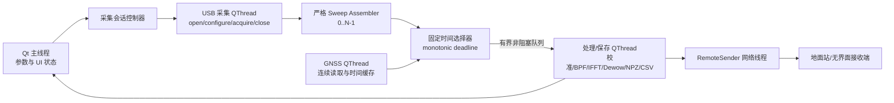

# LibreVNA 持久 USB 连续采集功能开发路线图

## 1. 文档信息

| 项目 | 内容 |
| --- | --- |
| 目标项目 | `E:\UVA_GPR_system` |
| 外部参考项目 | `E:\钢筋仪软件开发`（只读，不修改） |
| 应用场景 | 无人机冰层厚度测量 |
| 文档状态 | 待关键选择确认后实施 |
| 编制日期 | 2026-08-11 |

本文档用于指导 UAV-GPR 项目将 LibreVNA 采集方式从“每采一条数据重新打开、配置和关闭 USB”升级为“任务期间持久连接、设备连续扫频、应用层定时选择数据”的实施过程。

本路线图只描述功能开发和验收路径，不授权覆盖当前工作区中的既有未提交修改。实施时必须先记录 Git 状态，保留现有 B-scan、GNSS、信号处理和测试成果，禁止使用 `git reset --hard`、`git checkout --`、`git clean` 等破坏性操作。

## 2. 建设目标

最终系统应满足以下要求：

1. 任务开始时只打开并 claim 一次 LibreVNA USB。
2. 正常、不暂停且不重连的任务只发送一次连续扫频配置。
3. LibreVNA 在后台持续产生完整 sweep，USB 线程持续排空数据流。
4. 应用层按照固定 monotonic 时间表选择需要处理、保存和发送的完整 sweep。
5. 每条选中数据记录采集时间、GNSS、飞行高度、设备配置和完整性统计。
6. 停止任务时执行 `SET_IDLE`，随后释放 interface 和 USB 资源。
7. S11 和 S22 必须从同一个 `VNADatapoint` 解析，不能跨包拼出一个频点。
8. 每条 sweep 必须严格由连续的 `point_number=0..N-1` 组成。
9. 丢点、重复、跳号、越界、无效复数或协议损坏时废弃整条 sweep。
10. 不允许跨 sweep、暂停边界、超时边界或重连边界拼接数据。
11. 空中端现有 UI、处理流水线、CSV/NPZ 和地面传输尽可能保持兼容。
12. 外部参考项目和当前项目的参考代码、历史报告保持只读。

## 3. 非目标

本轮不包含以下工作：

- 修改 LibreVNA 固件或外部参考项目；
- 改变 `uav-gpr-telemetry-v1` framing；
- 重写现有 BPF、IFFT、Dewow、Flat Reflection 算法；
- 仅凭 GNSS 海拔推断准确的离冰面 AGL 高度；
- 在未完成真机验证前删除 legacy 采集回退路径；
- 在本轮混入新的冰厚反演算法。

## 4. 当前问题基线

当前主调用链为：

```text
MainWindow.start_acquisition
  -> AcquisitionWorker.run
    -> acquire_sparameters
      -> open_device
      -> RequestDeviceInfo
      -> SET_IDLE
      -> SWEEP_SETTINGS
      -> 读取一条 sweep
      -> SET_IDLE
      -> release_interface / dispose_resources
    -> 校准/背景/BPF/IFFT/Dewow
    -> 阻塞读取 GNSS
    -> CSV/NPZ 压缩保存
    -> Qt UI 信号和远程发送
    -> sleep(interval_s)
```

因此当前 UI 中设置的 `interval_s` 并不是实际固定采集间隔：

```text
实际间隔 = USB 重建 + sweep + GNSS 等待 + 处理 + 保存 + interval_s
```

当前实现还存在以下完整性风险：

- 使用字典按点号覆盖，不能可靠识别重复点和跨 sweep 污染；
- 等待 ACK 时可能丢弃同批到达的 `VNADatapoint`；
- receiver descriptor 重复或复数无效时缺少严格拒绝；
- GNSS 串口和 NPZ 压缩会阻塞 USB 数据流；
- 当前双端口动态 stages 计算可能得到 `0x2441`，而参考项目真机验证值为 `0x1241`；
- UI 关闭时没有完整的采集线程停止和 USB 释放确认。

## 5. 目标架构



职责边界：

- Qt 主线程不访问 USB、串口、磁盘压缩或阻塞 socket。
- USB 线程独占 LibreVNA transport，持续消费每条完整 sweep，不执行保存间隔 sleep。
- GNSS 线程连续读取 NMEA，并按 host monotonic 时间保存最近 Fix。
- 处理线程只处理应用层选中的 sweep，避免对被时间抽样跳过的数据做昂贵计算。
- 网络线程保持独立，网络波动不得阻塞 USB 数据流。

## 6. 目标状态机

| 状态 | 允许操作 | 行为与下一状态 |
| --- | --- | --- |
| `CLOSED` | `open()` | 打开、claim、读取 DeviceInfo、`SET_IDLE`，进入 `OPEN_IDLE` |
| `OPEN_IDLE` | `configure(config)` | 校验能力、清旧流、发送 `SWEEP_SETTINGS 0x1241`，进入 `STREAMING` |
| `STREAMING` | `acquire_one()` | 返回下一条完整有效 sweep，状态保持不变 |
| `STREAMING` | `pause()` | 在完整 sweep 边界执行 `SET_IDLE`，清 partial/pending，进入 `PAUSED` |
| `PAUSED` | `resume()` | 使用冻结配置重发 SweepSettings，不 reopen，进入 `STREAMING` |
| 任意已打开状态 | `close()` | 尽力 `SET_IDLE`，始终释放 USB，进入 `CLOSED` |
| 命令或设备状态不可确定 | — | 进入 `FAULTED`，禁止继续采集，只允许 close/reopen |

正常任务只执行一次 `open()` 和一次 `configure()`。暂停后恢复必须重发同一 SweepSettings，但不重新打开 USB、不改变冻结配置。

## 7. 文件实施地图

### 7.1 新增文件

#### `librevna/librevna_protocol.py`

负责纯协议逻辑：

- packet 常量、`Packet` 和 `PacketStream`；
- DeviceInfo 解码；
- `SweepSettings` 编码；
- 已验证 stages 常量 `0x1240`、`0x1241`；
- `parse_vna_datapoint()`；
- 同包 `parse_s11_s22_point()`；
- 若确认保留四通道，增加严格的四 S 参数解析器；
- 不导入 PyUSB、Qt 或业务 UI。

#### `librevna/librevna_transport.py`

负责 PyUSB 生命周期：

- `open/read/write/close/is_open`；
- 惰性加载 PyUSB 和 `libusb_package`；
- 映射未找到、占用、timeout、断开和释放错误；
- 支持 Fake transport 注入；
- 保证 `open/close` 幂等。

#### `librevna/librevna_continuous.py`

负责连续采集：

- `BackendState`；
- `ContinuousSweepAssembler`；
- `CompleteSweep`；
- `SessionStatistics`；
- `PersistentLibreVnaBackend`；
- pending 队列、ACK 共批数据保留、超时与 fail-closed；
- open/configure/acquire_one/pause/resume/close。

#### `acquisition_scheduler.py`

负责应用层时间抽样：

- `FixedIntervalSweepSelector`；
- 固定 monotonic deadline；
- interval=0 的逐 sweep 模式；
- missed slot、实际间隔和调度误差统计；
- 纯 Python 单元测试，不依赖 Qt 或硬件。

### 7.2 修改文件

#### `librevna/librevna_usb_probe.py`

- 保持探测 CLI 和兼容入口；
- 在固定字节测试通过后复用新 protocol 定义；
- 不改变现有探测工具使用方式。

#### `librevna/librevna_usb_s11.py`

- 保持 OSL 数学、CLI 和短会话兼容函数；
- 协议函数逐步统一到新 protocol；
- 主任务不再调用 `acquire_sparameters()`；
- 手动测试、标准件和背景采集可暂时继续使用 legacy 短会话；
- 任务运行时禁用会竞争 USB 的手动按钮。

#### `uav_gpr_qt.py`

- 重构 `AcquisitionWorker` 为持续 USB 生产者；
- 新增 GNSS 连续读取线程；
- 新增处理/保存消费者线程或等价组件；
- 用 `threading.Event` 实现 stop/pause/resume；
- 冻结任务配置；
- `save_trace()`、`trace_npz_bytes()` 和 `RemoteSender` 接收采集 metadata；
- 修复 `closeEvent()`，等待工作线程退出和 USB 释放；
- 显示 sweep rate、丢弃数、实际间隔和 GNSS age；
- 保留现有 B-scan、双通道 UI 和信号处理流水线。

#### `uav_gpr_ground_station.py`

- 兼容解析新增的 acquisition metadata；
- 显示采集时间、设备 sweep 序号、GNSS age、飞行高度和完整性统计；
- 如确认需要，增加 pause/resume 远程命令；
- 旧 payload 缺少新增字段时继续工作。

### 7.3 原则上保持不变

- `uav_gpr_receiver.py`：继续把 payload 当作不透明 NPZ 保存；
- `gpr_processing.py`：不改变已完成的处理算法；
- `bscan_view.py`；
- `gnss_map_widget.py`，除非增加 AGL 显示字段；
- `uav-gpr-telemetry-v1` framing、SHA-256 和 ACK；
- `reference_code/`、已有参考文档和外部项目。

## 8. Sweep 完整性规则

Assembler 只接受：

```text
0 -> 1 -> 2 -> ... -> N-1
```

处理规则：

1. 只有 point 0 能开始新 sweep。
2. 新 point 0 打断旧 partial 时，旧 sweep 计为 dropped/incomplete。
3. 重复、回退、跳号、越界会立即作废当前 sweep。
4. 失步后忽略所有非零点，直到下一次 point 0。
5. S11、S22 的 receiver 和 reference 必须位于同一个 `VNADatapoint`。
6. 必需 descriptor 必须各出现一次，缺失或重复均为无效点。
7. reference 为 0、频率或复数包含 NaN/Inf 时废弃当前 sweep。
8. 完成时验证数量、频率有限且严格递增。
9. 使用设备实际返回的频率轴。
10. pause、timeout、reconnect 和 configure 边界必须清空 partial。

pending 队列要求：

- `acquire_one()` 先消费 pending，再执行 USB read；
- ACK 等待期间的 VNADatapoint 必须进入 pending；
- 一次 read 跨越两条 sweep 时，剩余 packet 不得丢失；
- pending 建议上限为 `max(4*N, 1024)`，溢出后 fail-closed；
- pause 成功后清除 pending、PacketStream 半包和 partial sweep。

## 9. 时间抽样和时间戳

### 9.1 设备采集

USB 工作线程持续调用 `acquire_one()`，不使用 `sleep(interval_s)`。每条完整 sweep 都参与设备吞吐和完整性统计。

### 9.2 应用选择

推荐保持当前“第一条立即保存”的用户体验：

```text
interval = 0：选择每条有效 sweep

interval > 0：
    第一条有效 sweep 立即选择
    next_due = first_sweep_time + interval
    后续选择第一条 acquisition_time >= next_due 的完整 sweep
    next_due 按固定周期递增，禁止用 now + interval
```

如果一次跨过多个 deadline，只选择当前一条 sweep，并记录错过的时间槽，不能重复保存同一 sweep。

### 9.3 每条数据时间字段

建议新增 `acquisition` JSON：

```json
{
  "acquired_at_utc": "sweep 中点 UTC",
  "sweep_started_utc": "首点主机接收 UTC",
  "sweep_completed_utc": "末点主机接收 UTC",
  "scheduled_at_utc": "计划采样时刻",
  "selected_at_utc": "应用选择时刻",
  "saved_at_utc": "文件完成时间",
  "device_sweep_index": 0,
  "selected_trace_index": 1,
  "connection_generation": 1,
  "target_interval_s": 1.0,
  "actual_interval_s": 1.01,
  "schedule_error_ms": 10.0,
  "gnss_age_ms": 80.0,
  "session_statistics": {}
}
```

LibreVNA 数据包没有硬件 UTC，因此这些时间是主机接收时间。规范采集时间建议使用 sweep 首末点时间的中点，同时保留首点和末点时间。

## 10. GNSS 和飞行高度

GNSS 必须改为独立线程连续读取，不能在每条 radar trace 后阻塞 `read_gga()`。

GNSS 缓存建议保存最近若干秒 Fix，并包含：

- NMEA UTC；
- 主机接收 UTC；
- host monotonic 时间；
- 经纬度；
- fix quality；
- 卫星数；
- HDOP（如可解析）；
- GGA 海拔；
- RMC 地速（如可解析）。

每条 sweep 按采集中点匹配最近且未过期的 Fix。无 Fix 或 Fix 超龄时不得把旧坐标伪装为有效数据，应记录 `gnss_valid=false` 和实际 age。

高度字段必须区分：

```text
gnss_altitude_msl_m   GNSS 海拔
flight_height_agl_m   无人机距冰面的对地高度
```

当前项目只有 GGA 海拔，不能直接得到准确 AGL。飞行高度的数据源必须在实施前确认。

## 11. 格式和协议兼容

兼容原则为“保留旧字段，只增加新字段”：

- CSV 现有频域列名和顺序不删除；
- NPZ 保留 `config`、`processing`、`frequency_hz`、`time_ns`、`gnss`、现有 S 参数和 trace key；
- NPZ 新增 `acquisition`，必要时新增 `flight`；
- `run_metadata.jsonl` 增加完整采集元数据；
- 遥测协议继续使用 `uav-gpr-telemetry-v1`；
- header 保留现有 `timestamp`，新增 `acquired_at_utc` 和 `acquisition`；
- 地面端和无界面接收端应忽略不认识的新增字段；
- 使用旧 NPZ、新 NPZ 和旧 ground station 行为做回归测试。

## 12. S21/S12 迁移策略

第一阶段建议继续保留 S21/S12：

- 最大限度保持 CSV、NPZ、校准和遥测兼容；
- 在双 stage 模式下交叉接收机通常已位于同一个 VNADatapoint，不显著增加设备 sweep 时间；
- 代价是处理、压缩、存储和网络数据量较大。

若直接移除：

- 需要修改 `S_PARAMETERS`、Through 校准、保存、遥测和测试；
- 旧消费者可能缺少预期 key；
- 应引入明确的数据 schema 版本或兼容层。

因此路线图默认“先保留、后单独评估移除”。最终决定见第 18 节。

## 13. 异常与恢复策略

| 场景 | 处理 |
| --- | --- |
| 无效、重复、跳号点 | 丢整条 sweep，等待下一个 point 0 |
| 单次 sweep timeout | 丢 partial、计数、继续重同步 |
| 连续多次 timeout | 关闭当前会话并进入重连 |
| 采集中 NACK | fail-closed，禁止继续采集，close/reconnect |
| USB 断开 | 丢 partial、清 pending、释放本地状态、重连 |
| payload 截断 | 协议错误，不尝试补包拼 sweep |
| GNSS 无 fix | 雷达继续，保存 invalid/stale 标记 |
| GNSS 串口断开 | GNSS 线程单独重试，不影响 USB |
| 本地保存失败 | 默认终止任务并明确报错 |
| 网络断开 | 本地继续，按确认的队列/补传策略处理 |
| Stop | 停止选择新数据，finally SET_IDLE/close |
| Pause | 完整 sweep 边界 SET_IDLE，清边界残留 |
| UI 关闭 | request stop + 有界 wait；不得 terminate 活线程 |

建议自动重连退避：

```text
0.5 s -> 1 s -> 2 s -> 5 s
```

每次重连增加 `connection_generation`，并彻底清空 assembler、pending 和 PacketStream，保证不同连接代的数据不能拼接。

## 14. 性能与运行指标

运行时至少记录：

- 有效完整 sweep/s；
- 设备总 sweep 数；
- dropped/incomplete/duplicate/jump/out-of-range/invalid；
- 应用选择数和因时间抽样跳过数；
- missed schedule slots；
- pending、处理和网络队列深度及溢出数；
- 目标保存间隔；
- 实际采集间隔 mean/p95/max；
- 调度误差 mean/p95/max；
- GNSS age；
- 相邻有效位置的实际空间间距；
- 校准、处理、保存、发送耗时；
- USB open/configure/reconnect 次数。

建议验收门槛：

1. 正常任务 `open_count=1`、`configure_count=1`。
2. 所有返回数据均为完整 N 点。
3. 模拟测试跨 sweep 拼接数为 0。
4. 系统处理能力足够时 `missed_schedule_slots=0`。
5. 实际间隔误差 p95 不超过一个完整 sweep 周期。
6. 定时保存启用后的有效 sweep rate 不低于同参数纯采集基线的 90%。
7. pending 和工作队列不持续增长。
8. Stop 到 USB 释放目标小于 2.5 秒。
9. 实际空间间距由相邻有效 GNSS 位置和采集时间计算，不把配置间隔当作实测距离。

## 15. 测试矩阵

### 15.1 协议单元测试

- 固定 packet 编码和 CRC；
- PacketStream 噪声、粘包、半包、非法长度；
- `0x1240`、`0x1241` 固定 payload；
- S11/S22 同包解析；
- descriptor 乱序、缺失、重复；
- reference 为 0；
- NaN/Inf；
- payload 截断和非法分组长度。

### 15.2 Assembler 单元测试

- 完整 `0..N-1`；
- 初始非零点；
- 丢点、重复、跳号、回退、越界；
- 新 point 0 打断 partial；
- 两条 sweep 连续到达；
- 一次 read 跨两条 sweep；
- 非递增和非有限频率；
- pause、timeout、reconnect 后不拼接；
- 统计计数语义。

### 15.3 Fake transport 测试

- 多 sweep 只 open/configure 一次；
- ACK 和首个 datapoint 同批到达；
- pending 不丢数据；
- NACK、ACK timeout、USB disconnect；
- close 时 SET_IDLE 失败仍释放；
- pause/resume 不 reopen；
- reconnect 后 generation 变化；
- 慢处理消费者不阻塞 USB 生产者。

### 15.4 定时和 GNSS 测试

- interval=0；
- 第一条立即选择；
- 固定 deadline 无累计漂移；
- 跨过多个 deadline；
- 有限 count；
- GNSS 最近 Fix、过期 Fix、无 Fix；
- acquisition metadata JSON 可序列化；
- 空间距离计算。

### 15.5 Qt 和兼容测试

- USB 不在主线程；
- start 后立即 stop；
- UI 在 USB read 时仍响应；
- closeEvent 等待线程退出；
- pause/resume 状态；
- 重复启停无残留线程；
- 旧/new NPZ 均可由地面端显示；
- `uav_gpr_receiver.py` 原样保存新增 header/payload。

### 15.6 真机验收

1. 确认固件、protocol 和 `0x1241` ACK。
2. 抓取 VNADatapoint，确认 S11/S22 同包和 descriptor。
3. 验证 101 点及当前 201 点严格循环 `0..N-1`。
4. 依次测纯采集、处理、本地保存和网络发送性能。
5. 连续运行至少 30 分钟，最终进行 1～2 小时压力测试。
6. 真实拔插 USB，确认不跨 reconnect 拼接。
7. 多轮 pause/resume。
8. GNSS 有效、无效、陈旧和断开测试。
9. 与真实飞行高度源对拍。
10. 冰面试飞验证采集间隔和实际空间间距。

## 16. 分阶段路线图

### 阶段 0：基线冻结

任务：

- 记录当前 Git staged、unstaged 和 untracked 状态；
- 最好提交或备份上一轮已验收修改；
- 保存旧 NPZ、CSV 和地面接收样本；
- 记录现有测试基线。

验收：能够明确区分本功能和既有修改。

回退：无代码变更。

### 阶段 1：纯协议和严格 assembler

任务：

- 新增 `librevna_protocol.py`；
- 新增 strict assembler；
- 建立协议和序列单元测试；
- 暂不切换 UI 调用链。

验收：所有点序异常均丢整条，固定协议字节与参考实现一致。

回退：删除新增模块；旧采集路径完全不受影响。

### 阶段 2：持久 transport 和 backend

任务：

- 新增可注入 transport；
- 实现后端状态机；
- 完成 pending、ACK、timeout、fail-closed；
- 保留 legacy 主入口。

验收：Fake transport 连续 100 条只 open/configure 一次，无拼接和丢 pending。

回退：主程序继续使用 `acquire_sparameters()`。

### 阶段 3：时间选择和线程解耦

任务：

- 重构 USB worker；
- 新增时间选择器；
- 新增 GNSS 连续线程和处理/保存线程；
- 使用有界队列；
- 加入 legacy/continuous feature flag。

验收：USB worker 中无保存 interval sleep、GNSS read、NPZ 压缩和网络等待；模拟慢消费者时 USB 仍持续排流。

回退：feature flag 切回 legacy。

### 阶段 4：metadata 和地面兼容

任务：

- 增加 acquisition、GNSS age 和高度字段；
- 地面端显示新增状态；
- 保持遥测 framing；
- 完成旧、新数据回归。

验收：旧数据正常显示，新数据包含完整时间和统计；无界面 receiver 无需协议重写。

回退：停用新增 UI 字段；新增 metadata 本身保持向后兼容。

### 阶段 5：真机地面压力测试

任务：

- 纯采集、保存、网络分层 benchmark；
- USB 拔插；
- GNSS 和 pause/resume；
- 长时间稳定性测试。

验收：满足第 14 节性能门槛和第 15 节硬件测试。

回退：持续使用 legacy backend，保留新代码用于诊断。

### 阶段 6：飞行验收和默认切换

任务：

- 冰面低速试飞；
- 对拍 GNSS、飞行高度、采集时间和空间间距；
- 确认断链和重连策略；
- continuous backend 改为默认。

验收：飞行数据完整、时间和位置可追溯、空间间距符合任务要求。

回退：启动参数切回 legacy，不改变已保存数据格式。

## 17. 阶段依赖与里程碑


| 里程碑 | 判定条件 |
| --- | --- |
| M1 数据完整性闭环 | 协议、同包 S11/S22、严格 0..N-1 全部单测通过 |
| M2 持久会话闭环 | Fake transport 证明一次 open/configure 获取多条 sweep |
| M3 实时架构闭环 | USB、GNSS、处理、保存和网络线程职责完全解耦 |
| M4 兼容性闭环 | 新旧 NPZ、地面站和 headless receiver 回归通过 |
| M5 硬件闭环 | 真机长时间运行、异常恢复和性能门槛通过 |
| M6 任务闭环 | 冰面试飞证明时间、位置、高度和空间间距满足要求 |

## 18. 实施前决策门

开始编码前必须由项目负责人确认：

- [ ] S21/S12 第一阶段继续保留，还是立即移除？
- [ ] 飞行高度使用 GGA 海拔、飞控 AGL、激光测距，还是 RTK+冰面高程？
- [ ] 规范 `acquired_at` 使用 sweep 首点还是 sweep 中点？
- [ ] 定时选择使用 deadline 后第一条，还是离 deadline 最近的一条？
- [ ] 第一条数据立即保存，还是等待一个 interval？
- [ ] 有限 count 按已选择、已处理还是成功落盘计数？
- [ ] 处理队列满时丢最旧、丢最新，还是终止任务？
- [ ] 网络断开后允许丢远程实时包，还是必须磁盘排队补传？
- [ ] 是否自动重连；最大次数、总时长和允许的数据空档是多少？
- [ ] GNSS 最大允许 age 是多少；超龄后保存 stale 还是拒绝 radar trace？
- [ ] 是否同时增加空中端和地面端 pause/resume 控件？
- [ ] 标准件与背景采集是否同步迁移为持久会话？
- [ ] legacy backend 保留几个版本或多少次现场任务？

## 19. 每阶段完成报告模板

```text
阶段：
完成状态：完成 / 部分完成 / 阻塞

修改文件：
- 文件：修改内容

实现结果：
- 对应需求：结果

测试：
- 命令：
- 结果：

指标：
- open/configure 次数：
- complete/dropped sweep：
- sweep rate：
- 实际保存间隔：
- 队列溢出：

兼容性：
- 旧 NPZ：
- 地面端：
- 网络协议：

未验证事项：
- 真机/飞行/异常场景

回退方式：
- feature flag 或具体恢复步骤
```

## 20. 参考资料

当前项目：

- `E:\UVA_GPR_system\librevna\librevna_usb_s11.py`
- `E:\UVA_GPR_system\librevna\librevna_usb_probe.py`
- `E:\UVA_GPR_system\uav_gpr_qt.py`
- `E:\UVA_GPR_system\uav_gpr_ground_station.py`
- `E:\UVA_GPR_system\uav_gpr_receiver.py`
- `E:\UVA_GPR_system\reference_code\rebar_inspector_s11_s22_reference.py`
- `E:\UVA_GPR_system\docs\钢筋仪项目_S11_S22_采集与校准参考.md`

外部只读参考：

- `E:\钢筋仪软件开发\src\rebar_inspector\acquisition\librevna_usb.py`
- `E:\钢筋仪软件开发\src\rebar_inspector\acquisition\librevna_protocol.py`
- `E:\钢筋仪软件开发\src\rebar_inspector\acquisition\librevna_usb_transport.py`
- `E:\钢筋仪软件开发\src\rebar_inspector\acquisition\backend.py`
- `E:\钢筋仪软件开发\src\rebar_inspector\acquisition\sweep_config.py`
- `E:\钢筋仪软件开发\src\rebar_inspector\ui\acquisition.py`

