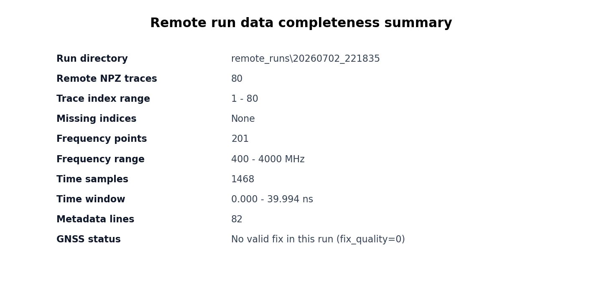
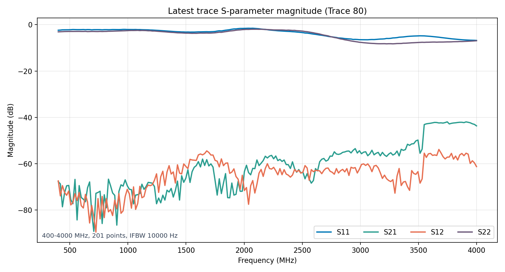
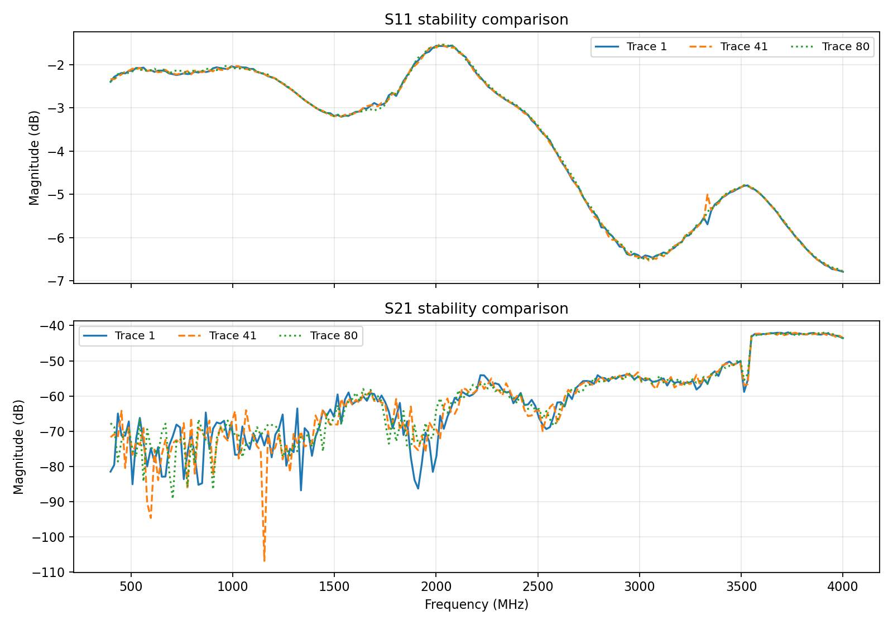
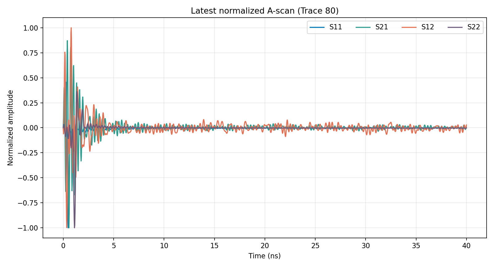
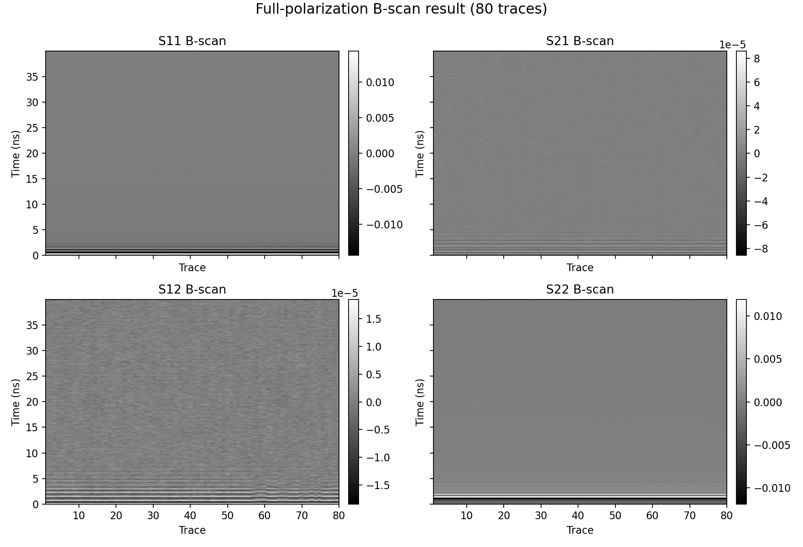
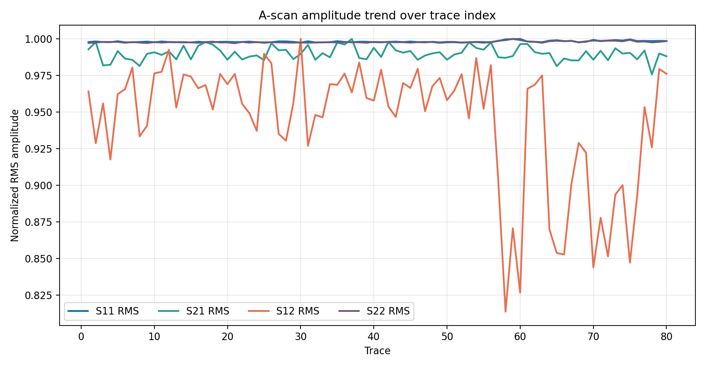

# UAV-GPR 双电脑远程采集数据结果报告

版本日期：2026-07-05

## 1. 报告重点

本报告重点展示当前远程采集链路已经接收到的数据结果，而不是只展示软件架构。数据来源为 A 端远程接收目录：

```text
remote_runs/20260702_221835
```

该目录包含一次远程采集 run 的完整 NPZ 数据，可用于验证：

- B 端采集数据是否成功回传 A 端。
- A 端是否保存了连续 trace。
- 四个极化通道 `S11/S21/S12/S22` 是否都完整。
- A 端是否能绘制 S 参数、A-scan、全极化 B-scan。

## 2. 数据集概况



本次数据集摘要：

| 项目 | 结果 |
|---|---|
| 数据目录 | `remote_runs/20260702_221835` |
| 远程接收 NPZ 数量 | 80 条 |
| Trace 序号范围 | 1 - 80 |
| 缺失序号 | 无 |
| 频率点数 | 201 |
| 频率范围 | 400 - 4000 MHz |
| 时域采样点 | 1468 |
| 时域窗口 | 约 0 - 39.99 ns |
| 极化通道 | `S11/S21/S12/S22` |
| GNSS 状态 | 本次 run 未获得有效定位，`fix_quality=0` |

结论：该 run 的远程数据接收是连续的，未发现 trace 序号缺失；四通道字段完整，适合用于验证远程全极化显示。

## 3. 最新 Trace 的 S 参数结果

下图为最新一条远程 trace，即 Trace 80 的四通道 S 参数幅度曲线。



图中显示：

- 横轴为频率，单位 MHz。
- 纵轴为幅度，单位 dB。
- 四条曲线分别对应 `S11/S21/S12/S22`。
- 该图来自 A 端接收到的远程 NPZ 数据，而非本地 UI 临时缓存。

该图可用于验证：

- 频域数据成功从 B 端传输至 A 端。
- 四个 S 参数通道均已传输。
- A 端报告生成流程可直接读取远程保存结果。

## 4. S 参数稳定性对比

下图对比了 Trace 1、中间 trace、Trace 80 的 `S11` 和 `S21` 曲线。



该图用于观察连续采集过程中频域曲线是否发生明显漂移或突变。

初步观察：

- 本次 run 中 `S11` 和 `S21` 在多条 trace 间可以进行一致性比较。
- 若后续现场采集目标或飞行平台移动，曲线随 trace 变化将对应空间位置变化或目标响应变化。
- 当前报告只做结果呈现，不对地下目标做解释性判读。

## 5. 最新 Trace 的 A-scan 结果

下图为 Trace 80 的四通道归一化 A-scan。



图中显示：

- 横轴为 time，单位 ns。
- 纵轴为归一化幅值。
- `S11/S21/S12/S22` 四个通道均有时域 trace。

该图用于验证：

- 频域 S 参数已经转换为时域 trace。
- A 端可以显示每条 trace 的四通道 A-scan。
- 后续 B-scan 是由多条 A-scan 按 trace 序号堆叠得到。

## 6. 全极化 B-scan 结果

下图为本次 80 条 trace 组成的全极化 B-scan。



B-scan 坐标定义：

```text
横轴：Trace
纵轴：Time, ns
```

四个子图分别为：

- `S11 B-scan`
- `S21 B-scan`
- `S12 B-scan`
- `S22 B-scan`

该图是当前报告中最关键的数据结果图。它说明：

- A 端远程保存的数据可以按 trace 序号连续堆叠。
- 全极化四通道均具备 B-scan 显示能力。
- 当前地面站界面的 B-scan 坐标修正方向是正确的：横轴 trace，纵轴 time。

## 7. Trace 幅值趋势

下图统计了 80 条 trace 的四通道归一化 RMS 幅值变化。



该图用于快速检查：

- 连续采集过程中是否存在明显异常跳变。
- 是否有某个通道出现突然失真、掉线或幅值塌陷。
- 后续可作为质量控制图加入地面站。

建议后续在 A 端实时界面中增加类似质量指标：

- 每通道 RMS。
- 每通道 peak。
- trace 接收速率。
- 缺失 trace 数量。
- ACK 延迟。

## 8. 当前远程链路测试状态

当前 A/B 网络状态：

| 项目 | 结果 |
|---|---|
| A 端热点 IP | `192.168.137.1` |
| B 端热点 IP | `192.168.137.244` |
| B -> A ping | 成功 |
| ping 延迟 | 约 1-4 ms |
| A 端地面站监听 | `0.0.0.0:8765` |

当前已有历史远程数据证明链路曾成功完成 B->A 数据传输。本次实时检查时，A 端处于监听状态，但尚未观察到新的 B->A `ESTABLISHED` 会话。下一次联调时需要确认 B 端运行的是更新后的 `uav_gpr_qt.py`。

## 9. 当前实现说明

### 9.1 A 端

A 端地面站脚本：

```text
uav_gpr_ground_station.py
```

功能：

- 远程控制 B 端采集。
- 设置 A-scan 数量与采集间隔。
- 接收 trace NPZ。
- 显示 S 参数、A-scan、全极化 B-scan。
- 保存远程数据。

### 9.2 B 端

B 端采集脚本：

```text
uav_gpr_qt.py
```

功能：

- 控制 LibreVNA 和 GNSS。
- 根据 A 端命令开始、单次采集、停止。
- 每条 trace 完成后发送四通道数据。

## 10. 下一阶段更稳定方案

当前版本已经具备验证能力，但仍属于自定义 TCP 原型。下一阶段建议从“能用”升级到“可靠可维护”。

### 10.1 短期增强

优先补充：

- heartbeat：判断 B 端是否在线。
- command_id：跟踪每条命令执行状态。
- end_run：采集任务完成通知。
- 状态消息：B 端上报 LibreVNA、GNSS、采集进度。
- 质量控制图：RMS、peak、trace rate、ACK latency。

### 10.2 断线续传

建议 B 端增加本地发送 manifest：

```text
run_id
trace_index
npz_path
sha256
sent_status
ack_status
retry_count
```

网络断开时：

- B 端继续本地保存。
- 未 ACK 的 trace 保留在队列。
- 网络恢复后自动补传。
- A 端按 `run_id + trace_index` 去重和校验。

### 10.3 更强工程方案

推荐升级为：

```text
gRPC 双向流 + Protocol Buffers + SQLite outbox
```

原因：

- gRPC 双向流适合 A 下发命令、B 回传状态和数据。
- Protocol Buffers 固定消息结构，减少 JSON 字段变化造成的问题。
- SQLite outbox 可实现持久化队列和断线续传。
- 大 trace 可以分 chunk 发送。
- 后续更容易扩展到多语言、多进程或服务化部署。

### 10.4 更远期扩展

如果未来需要多个接收端或云端归档，可考虑：

```text
MQTT / NATS / EMQX
```

但对于当前两台电脑热点直连场景，优先建议完成 gRPC + SQLite 版本。

## 11. 结论

从当前已有远程数据结果看，系统已经具备以下能力：

- B 端采集 trace 后传输到 A 端。
- A 端保存连续远程 NPZ。
- A 端可基于远程数据绘制 S 参数、A-scan 和全极化 B-scan。
- 80 条 trace 数据序号连续，四通道字段完整。

下一步的重点不是再画架构图，而是继续做真实采集联调和可靠性增强：确保 B 端更新程序后能稳定连接 A 端，并在采集中增加 heartbeat、ACK 延迟、断线续传和数据质量控制图。
