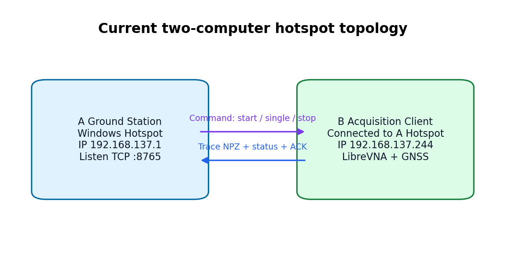
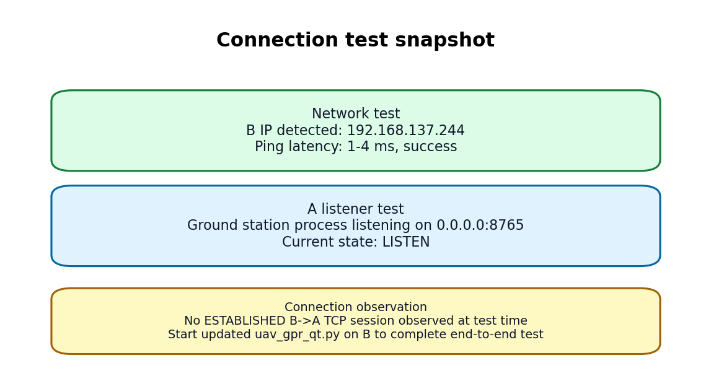
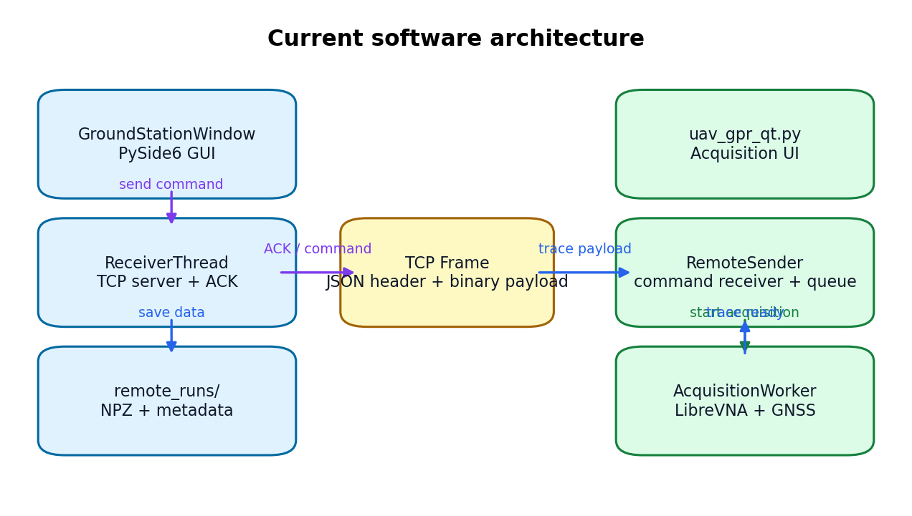
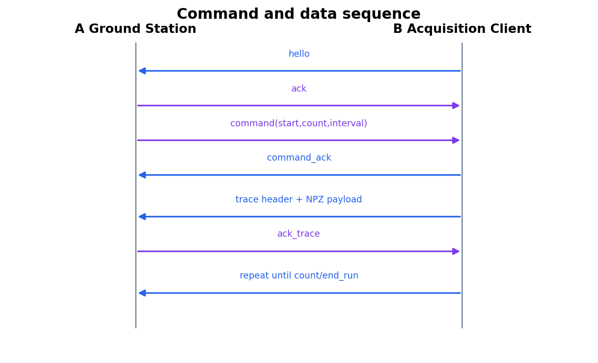
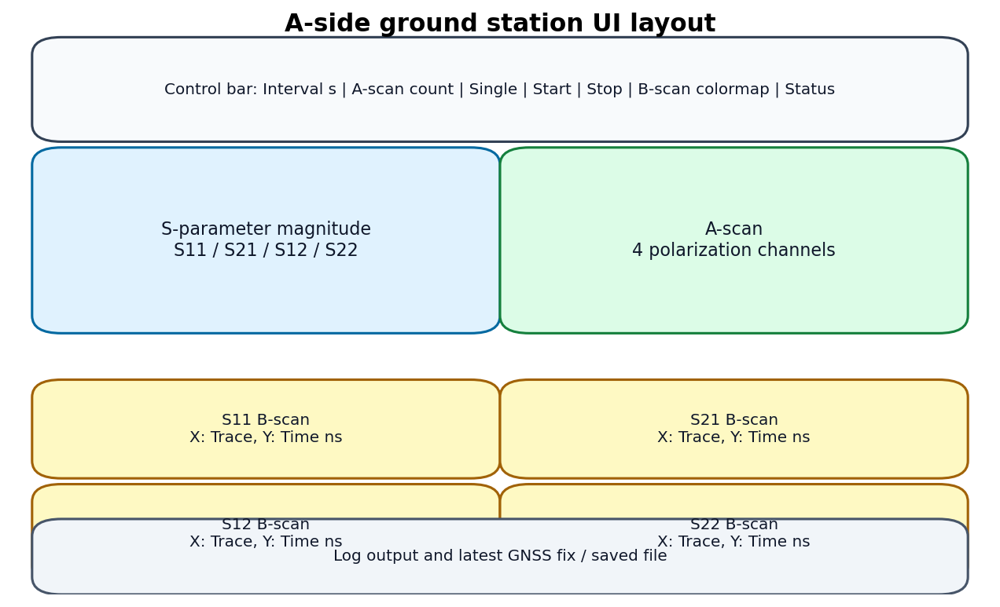
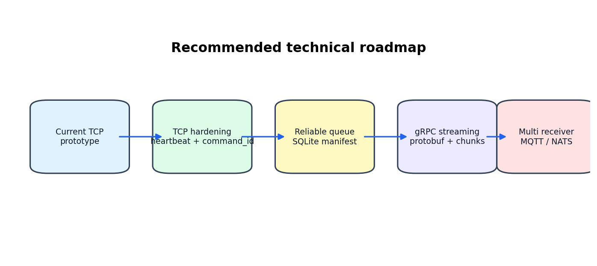

# UAV-GPR 双电脑远程采集地面站阶段技术报告

版本日期：2026-07-05

## 1. 报告目的

本报告整理当前 UAV-GPR 双电脑远程采集系统的阶段性成果、现场连接测试结果、软件架构、数据传输流程、界面显示方案，以及下一步更强、更稳定的技术升级计划。

当前系统已经从“B 端采集电脑手动启动”调整为“A 端地面站统一控制”：

- A 电脑负责热点、地面站界面、远程控制、数据接收、实时显示、远程保存。
- B 电脑负责连接 LibreVNA/GNSS，并按 A 端命令执行采集。
- A 端可设置采集多少个 A-scan、采集间隔，并显示全极化数据。

## 2. 当前网络连接测试

### 2.1 网络拓扑

当前采用 A 电脑开启 Windows 移动热点，B 电脑连接该热点的方式。



当前检测结果：

| 项目 | 结果 |
|---|---|
| A 电脑热点 IP | `192.168.137.1` |
| B 电脑热点网段 IP | `192.168.137.244` |
| B 到 A 网络连通性 | `ping` 成功 |
| ping 延迟 | 约 `1-4 ms` |
| A 端监听端口 | `0.0.0.0:8765` |
| A 端地面站进程 | 已启动并处于 `LISTEN` |
| 测试时 B->A TCP 会话 | 尚未观察到 `ESTABLISHED` |



说明：

- B 电脑已经接入 A 电脑热点，基础网络正常。
- A 端地面站已经监听 `8765` 端口。
- 测试时未看到 B 端采集软件到 A 端的 TCP 已建立连接，通常原因是 B 电脑尚未运行更新后的 `uav_gpr_qt.py`，或 B 端远程发送模块尚未连接成功。
- 下一次完整联调时，需要在 B 电脑运行更新后的采集程序，并观察 A 端地面站日志中是否出现 `Connected` 和 `Remote ready`。

## 3. 当前系统软件架构



### 3.1 A 端地面站

文件：

```text
uav_gpr_ground_station.py
```

职责：

- 启动 TCP server。
- 监听 B 端连接。
- 下发远程命令：
  - `start`
  - `single`
  - `stop`
- 接收 B 端 trace 数据。
- 校验 `sha256`。
- 保存远程数据到 `remote_runs/<run_id>/`。
- 实时显示：
  - S 参数曲线
  - A-scan
  - `S11/S21/S12/S22` 四通道 B-scan
  - GNSS 状态

启动命令：

```powershell
python .\uav_gpr_ground_station.py --host 0.0.0.0 --port 8765 --out .\remote_runs
```

### 3.2 B 端采集执行端

文件：

```text
uav_gpr_qt.py
```

职责：

- 连接 LibreVNA。
- 读取 GNSS 串口。
- 执行校准、采集、A-scan/B-scan 数据生成。
- 接收 A 端命令。
- 按 A 端设置的 `count` 和 `interval_s` 执行采集。
- 每条 trace 完成后发送压缩 NPZ 到 A。

启动命令：

```powershell
python .\uav_gpr_qt.py
```

默认远程配置：

```text
Remote send: enabled
Remote IP: 192.168.137.1
Port: 8765
```

## 4. 命令与数据传输流程

当前采用 Python 标准库 TCP socket，实现 JSON header + binary payload 的轻量协议。



### 4.1 帧格式

```text
4 bytes: JSON header length, uint32 big-endian
N bytes: JSON header, UTF-8
8 bytes: binary payload length, uint64 big-endian
M bytes: binary payload
```

### 4.2 当前消息类型

| 消息类型 | 方向 | 作用 |
|---|---|---|
| `hello` | B -> A | B 端连接后握手 |
| `ack` | A -> B | A 确认连接 |
| `command` | A -> B | 下发 `start/single/stop` |
| `command_ack` | B -> A | B 确认收到命令 |
| `trace` | B -> A | 发送一条 trace 的数据 |
| `ack_trace` | A -> B | A 确认保存成功 |

### 4.3 每条 trace 的传输内容

每条 trace 使用压缩 NPZ payload，包含：

```text
frequency_hz
time_ns
gnss
config
raw_S11 / raw_S21 / raw_S12 / raw_S22
display_S11 / display_S21 / display_S12 / display_S22
trace_S11 / trace_S21 / trace_S12 / trace_S22
```

这保证 A 端不依赖 B 端文件系统，也能实时显示和远程保存完整全极化数据。

## 5. A 端地面站界面

当前 A 端界面参考 B 端采集软件控制逻辑，已经补充采集数量与全极化显示。



### 5.1 控制区

支持：

- `Interval s`：设置采集间隔。
- `A-scan count (0=continuous)`：设置采集多少条 A-scan，`0` 表示连续采集。
- `Single`：采集一次。
- `Start`：开始采集。
- `Stop`：停止采集。
- `B-scan colormap`：选择 B-scan 色图。
- `Clear B-scan`：清空当前 B-scan。

### 5.2 显示区

支持：

- 四通道 S 参数曲线：`S11/S21/S12/S22`
- 四通道 A-scan 曲线
- 四通道全极化 B-scan：
  - `S11 B-scan`
  - `S21 B-scan`
  - `S12 B-scan`
  - `S22 B-scan`

B-scan 坐标定义：

```text
横轴：Trace
纵轴：Time, ns
```

## 6. 当前阶段成果

当前已经完成：

- A 电脑热点模式验证。
- B 电脑接入热点验证。
- A/B 网络 ping 测试。
- A 端地面站 TCP 监听。
- B 端远程发送模块。
- A 端远程控制 B 端采集逻辑。
- A 端采集数量与采集间隔设置。
- A 端全极化 B-scan 显示。
- trace 数据压缩 NPZ 传输。
- trace payload `sha256` 校验。
- 远程数据保存到 `remote_runs`。

当前尚需继续验证：

- B 端实际运行更新后的 `uav_gpr_qt.py` 后，是否自动建立 TCP 连接。
- A 端点击 `Start` 后，B 是否按指定 `A-scan count` 采集。
- 实际 LibreVNA/GNSS 数据是否能持续回传。
- 长时间连续采集是否有断线、卡顿、积压。

## 7. 当前方案风险与限制

当前版本是工程验证版，不是最终稳定版。主要风险：

- 自定义 TCP 协议缺少完整状态机。
- 缺少 heartbeat，A 端不能实时判断 B 端是否假死。
- 缺少持久化发送队列，断线后补传能力有限。
- 命令只有基础 ACK，缺少 `command_id` 和执行结果追踪。
- 当前只支持一个 B 端连接。
- 没有认证机制。
- 没有统一配置文件。
- Windows 防火墙、热点重启、网卡 IP 变化会影响连接。
- 需要进一步做真实采集压力测试。

## 8. 下一步工作计划

### 8.1 第一阶段：固化当前 TCP 地面站版本

目标：让当前版本适合短期现场试采。

任务：

- 增加 heartbeat：
  - B 每 1-2 秒向 A 发送状态。
  - A 超时后标记 B 离线。
- 增加连接状态：
  - 未连接
  - 已连接
  - 正在采集
  - 断线重连
  - 队列积压
- 增加 `command_id`：
  - A 每条命令带唯一 ID。
  - B 返回收到、开始执行、执行完成、执行失败。
- 增加 `end_run`：
  - B 完成指定数量采集后通知 A。
- 增加日志：
  - A 端地面站日志。
  - B 端远程发送日志。
- 增加链路测试按钮：
  - ping
  - TCP connect
  - hello/ack
  - test trace

### 8.2 第二阶段：断线续传

目标：网络波动不丢 trace。

任务：

- B 端建立本地 manifest 或 SQLite 队列。
- 每条 trace 保存后再发送。
- A 端按 `run_id + trace_index` 去重。
- A 端发现缺号后发送 `resend_request`。
- B 端从本地文件补传缺失 trace。
- A 端校验 sha256，冲突时报警。

### 8.3 第三阶段：升级为更强更稳定的技术方案

推荐升级方向：

```text
gRPC 双向流 + Protocol Buffers + SQLite outbox
```



推荐理由：

- gRPC 双向 streaming 非常适合当前场景：
  - A 下发命令。
  - B 回传状态。
  - B 连续发送 trace。
- Protocol Buffers 固定消息结构，减少 JSON 字段随意变化造成的兼容问题。
- gRPC 自带状态码、deadline、错误语义，比手写 TCP 更容易维护。
- 大 trace 可按 chunk 分块发送。
- SQLite outbox 可提供断线续传、程序重启后继续发送、ACK 状态持久化。

建议通信结构：

```text
ClientMessage:
  hello
  status
  trace_header
  trace_chunk
  end_run
  error_report

ServerMessage:
  ack
  command
  resend_request
```

建议本地可靠队列表：

```text
runs
traces
chunks
acks
```

### 8.4 第四阶段：多接收端或远距离链路

如果后续需要多地面站、云端归档或远距离链路，再引入：

```text
MQTT 5.0 / NATS / EMQX
```

topic 示例：

```text
uav_gpr/{device_id}/status
uav_gpr/{device_id}/command
uav_gpr/{device_id}/trace/header
uav_gpr/{device_id}/trace/chunk
uav_gpr/{device_id}/ack
```

对于当前两台电脑热点直连，优先建议先完成 gRPC + SQLite 版本。

## 9. 推荐验收测试

### 9.1 连接测试

- A 开热点。
- B 连接热点。
- A 地面站启动。
- B 启动更新后的采集端。
- A 显示 B 已连接。

### 9.2 远程采集数量测试

- A 设置 `A-scan count = 5`。
- A 点击 `Start`。
- B 自动采集 5 条。
- A 收到 5 条 trace。
- A 保存 5 个 NPZ。

### 9.3 全极化显示测试

- 检查 A 端四个 B-scan 是否同步更新：
  - `S11`
  - `S21`
  - `S12`
  - `S22`
- 检查 B-scan 坐标：

```text
横轴：Trace
纵轴：Time ns
```

### 9.4 停止测试

- A 设置连续采集。
- A 点击 `Start`。
- 采集中点击 `Stop`。
- B 停止采集。
- A 日志显示停止状态。

### 9.5 断线测试

- 采集中断开 B 的 Wi-Fi。
- B 应继续本地保存。
- 网络恢复后补传缺失 trace。

当前版本尚未完整实现补传，作为下一阶段重点。

## 10. 结论

当前系统已经具备双电脑远程采集的核心形态：

- A 端地面站统一控制。
- B 端执行采集。
- A 端实时接收和显示全极化数据。
- 热点直连网络已验证可用。

下一步建议先完成一次真实 B 端采集软件联调，确认 A 端能看到 `ESTABLISHED` 连接、能下发 `Start`、能接收真实 trace。之后立即推进 heartbeat、命令 ID、断线续传，再升级到 gRPC 双向流 + SQLite outbox 的稳定工程版本。
