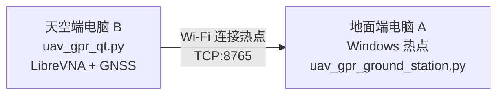
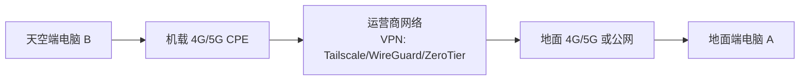
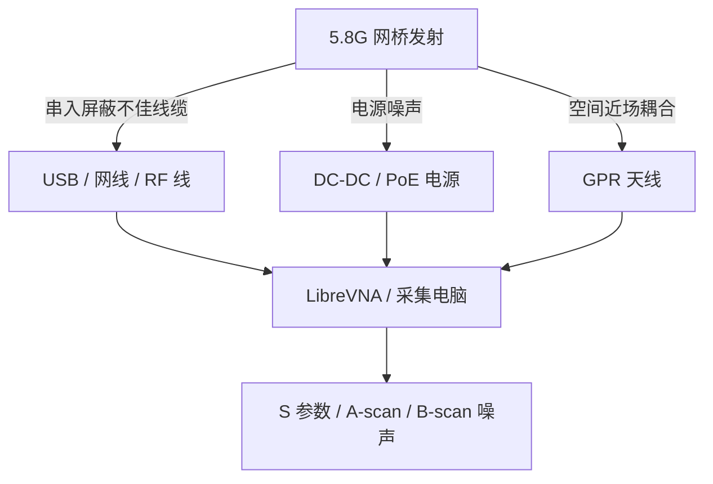
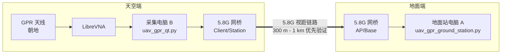
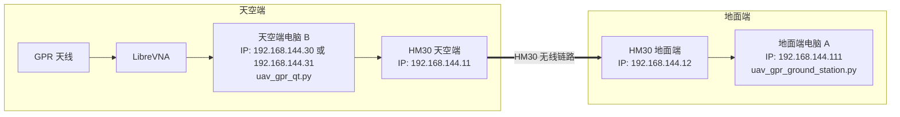

# UAV-GPR 远程数据传输方案汇总与 5.8G 网桥推荐方案

版本日期：2026-07-10

## 1. 需求背景

当前 UAV-GPR 系统的核心需求是把天空端电脑采集到的雷达数据稳定传到地面端电脑。天空端连接 LibreVNA、GNSS 和雷达天线，地面端负责接收、存档、实时显示和后处理。

当前雷达扫频范围约为：

```text
400 MHz - 4000 MHz
```

当前数据回传格式为：

```text
TCP socket + JSON header + 压缩 NPZ payload + sha256 校验
```

每条 trace 数据量通常为几十 KB。即使 10 Hz 连续采集，平均带宽需求也通常在数百 KB/s 到 1 MB/s 量级。因此，本项目远程传输的关键不是“带宽不够”，而是：

- 无线链路是否稳定；
- 飞行过程中是否容易掉线；
- 断线后是否能补传；
- 通信天线是否干扰 GPR 雷达天线和 LibreVNA；
- 设备重量、供电、安装方向是否适合无人机。

## 2. 所有可选远程传输方案

### 2.1 方案总览

| 方案 | 稳定距离预期 | 优点 | 缺点 | 适合程度 |
|---|---:|---|---|---|
| 笔记本 Windows 热点 | 10-30 m 稳定，几十米可试 | 不加硬件，最简单 | 距离短，抗干扰弱，容易受电脑省电/防火墙影响 | 仅适合室内和近距离调试 |
| 普通 Wi-Fi 路由器 | 30-100 m | 成本低，配置简单 | 天线增益有限，飞行姿态影响明显 | 适合场地联调 |
| 2.4G Wi-Fi/网桥 | 100 m-1 km，视设备而定 | 穿透略好，设备多 | 频段拥挤，可能更接近部分 GNSS/遥控/数传系统 | 不优先 |
| 专用 5.8G 无线网桥 | 300 m-2 km 稳定可做，视距好可更远 | 带宽高，频率避开 GPR 400 MHz-4 GHz，点对点成熟 | 需要视距和天线对准，机载安装要注意方向 | 推荐主方案 |
| 900M/1.4G/2.4G 专业数传 | 数 km 级 | 链路强，适合无人机 | 可能与其他遥控/图传/GPR 前端更接近，带宽和法规需核实 | 备选 |
| 4G/5G CPE + VPN | 运营商覆盖范围内 | 不依赖视距，远距离方便 | 延迟和掉线不可控，公网/VPN 配置复杂 | 远距离备选 |
| 专业无人机图数传链路 | 数 km 到十几 km | 工程可靠性高 | 成本高，接口和二次开发需评估 | 预算充足时考虑 |
| 本地存储为主，落地后取数 | 飞行全程 | 最可靠，不受链路影响 | 不能实时看数据 | 必须保留为兜底 |

结论：对当前系统，建议采用：

```text
本地保存兜底 + 5.8G 网桥实时回传 + 断线补传
```

## 3. 各方案图示

### 3.1 当前热点方案



适合短距离调试，不建议作为正式外场远距离方案。

### 3.2 5.8G 网桥方案


### 3.3 4G/5G VPN 方案



适合非视距或跨区域，但链路延迟、运营商覆盖和 VPN 配置不如 5.8G 点对点可控。

## 4. 为什么推荐 5.8G 网桥

5.8G 网桥对本项目比较合适，原因如下：

1. **频段避开 GPR 主扫频范围**

   GPR 当前扫频约 `400 MHz - 4000 MHz`，5.8G 网桥通常工作在 5GHz/5.8GHz 附近，主信号不直接落在雷达扫频范围内。相比 900M、1.4G、2.4G，5.8G 对当前雷达测量频段更友好。

2. **带宽余量很大**

   当前 trace 数据量不大。TP-Link CPE710 官方规格为 5GHz、867Mbps、23dBi 定向天线；Ubiquiti LiteBeam 5AC Gen2 官方规格为 450+ Mbps 总吞吐、23dBi 天线；MikroTik LHG 5 ac 官方规格为 5GHz、867Mbit/s、24.5dBi 天线。对几十 KB 到 1 MB/s 级别的雷达回传来说，带宽不是瓶颈。

3. **点对点链路比普通热点稳定**

   专用网桥具备定向天线、固定信道、链路质量监测、PoE 供电和室外防护，比笔记本热点更适合外场。

4. **软件无需大改**

   5.8G 网桥对电脑表现为普通以太网链路。当前 `uav_gpr_ground_station.py` 继续监听 `0.0.0.0:8765`，天空端只需要把 `Remote IP` 改成地面端固定 IP。

## 5. 推荐 5.8G 设备类型

### 5.1 TP-Link CPE710


特点：

- 5GHz 802.11ac，官方标称无线速率 867Mbps。
- 23dBi 高增益定向 2x2 MIMO 天线。
- IP65 室外防护，15kV ESD 和 6kV 防雷保护。
- 支持 20/40/80 MHz 信道带宽，发射功率可调。
- 适合低成本、快速验证。

官方资料：

- TP-Link CPE710 官方页：https://www.tp-link.com/us/business-networking/pharos-cpe/cpe710/

淘宝搜索：

- CPE710 一对网桥：https://s.taobao.com/search?q=TP-LINK%20CPE710%205.8G%20%E7%BD%91%E6%A1%A5%20%E4%B8%80%E5%AF%B9
- CPE710 发射端/接收端：https://s.taobao.com/search?q=TP-LINK%20CPE710%20%E5%8F%91%E5%B0%84%E7%AB%AF%20%E6%8E%A5%E6%94%B6%E7%AB%AF

京东搜索：

- CPE710 一对网桥：https://search.jd.com/Search?keyword=TP-LINK%20CPE710%205.8G%20%E7%BD%91%E6%A1%A5%20%E4%B8%80%E5%AF%B9
- CPE710 室外 CPE：https://search.jd.com/Search?keyword=TP-LINK%20CPE710%20%E5%AE%A4%E5%A4%96%20CPE

### 5.2 Ubiquiti LiteBeam 5AC Gen2


特点：

- 官方规格：450+ Mbps 总吞吐。
- 23dBi 天线增益。
- 1 个千兆 RJ45 网口。
- 24V 被动 PoE，最大功耗约 7W。
- 有链路距离、速率、错误包、运行时间等统计信息，现场调试友好。

官方资料：

- Ubiquiti LiteBeam 5AC 官方页：https://store.ui.com/us/en/products/litebeam-5ac

淘宝搜索：

- LiteBeam 5AC Gen2 一对网桥：https://s.taobao.com/search?q=UBNT%20LiteBeam%205AC%20Gen2%20%E4%B8%80%E5%AF%B9%20%E7%BD%91%E6%A1%A5
- LiteBeam 5AC 发射端/接收端：https://s.taobao.com/search?q=Ubiquiti%20LiteBeam%205AC%20%E5%8F%91%E5%B0%84%E7%AB%AF%20%E6%8E%A5%E6%94%B6%E7%AB%AF

京东搜索：

- LiteBeam 5AC Gen2 一对网桥：https://search.jd.com/Search?keyword=UBNT%20LiteBeam%205AC%20Gen2%20%E4%B8%80%E5%AF%B9%20%E7%BD%91%E6%A1%A5
- Ubiquiti 5G 网桥：https://search.jd.com/Search?keyword=Ubiquiti%205G%20%E7%BD%91%E6%A1%A5

### 5.3 MikroTik LHG 5 ac / LHG 5 ax


特点：

- LHG 5 ac 官方规格：5GHz 802.11a/n/ac，867Mbit/s，24.5dBi 栅格天线。
- 1 个千兆以太网口。
- 被动 PoE，官方页面列出 10-30V PoE 输入范围。
- RouterOS 功能强，适合网络能力较强的团队。

官方资料：

- MikroTik LHG 5 ac 官方页：https://mikrotik.com/product/lhg_5_ac
- MikroTik LHG 5 ax 官方页：https://mikrotik.com/product/lhg_5_ax

淘宝搜索：

- MikroTik LHG 5 ac 一对网桥：https://s.taobao.com/search?q=MikroTik%20LHG%205%20ac%20%E4%B8%80%E5%AF%B9%20%E7%BD%91%E6%A1%A5
- MikroTik LHG 5 ax 一对网桥：https://s.taobao.com/search?q=MikroTik%20LHG%205%20ax%20%E4%B8%80%E5%AF%B9%20%E7%BD%91%E6%A1%A5

京东搜索：

- MikroTik LHG 5 ac 一对网桥：https://search.jd.com/Search?keyword=MikroTik%20LHG%205%20ac%20%E4%B8%80%E5%AF%B9%20%E7%BD%91%E6%A1%A5
- MikroTik LHG 5 ax 一对网桥：https://search.jd.com/Search?keyword=MikroTik%20LHG%205%20ax%20%E4%B8%80%E5%AF%B9%20%E7%BD%91%E6%A1%A5

## 6. 收发端采购建议

5.8G 网桥一般按“一对”购买。对本项目而言：

```text
天空端：Client / Station / CPE
地面端：AP / Base / Bridge
```

如果商家区分“发射端”和“接收端”，本项目建议这样理解：

| 角色 | 安装位置 | 网络角色 | 连接对象 |
|---|---|---|---|
| 发射端 / 客户端 / Station | 天空端无人机 | 连接地面端 AP | 天空端电脑 B |
| 接收端 / 基站 / AP | 地面端三脚架或杆塔 | 等待天空端接入 | 地面端电脑 A |

通用淘宝入口：

- 5.8G 网桥一对：https://s.taobao.com/search?q=5.8G%20%E7%BD%91%E6%A1%A5%20%E4%B8%80%E5%AF%B9
- 5.8G 千兆网桥：https://s.taobao.com/search?q=5.8G%20%E5%8D%83%E5%85%86%20%E7%BD%91%E6%A1%A5
- 5.8G 室外 CPE 网桥：https://s.taobao.com/search?q=5.8G%20%E5%AE%A4%E5%A4%96%20CPE%20%E7%BD%91%E6%A1%A5
- PoE 供电器/网桥电源：https://s.taobao.com/search?q=24V%20PoE%20%E4%BE%9B%E7%94%B5%E5%99%A8%20%E7%BD%91%E6%A1%A5
- 屏蔽网线/室外网线：https://s.taobao.com/search?q=%E5%AE%A4%E5%A4%96%20%E5%B1%8F%E8%94%BD%20%E7%BD%91%E7%BA%BF%20%E7%BD%91%E6%A1%A5
- 磁环/抗干扰磁环：https://s.taobao.com/search?q=%E6%8A%97%E5%B9%B2%E6%89%B0%20%E7%A3%81%E7%8E%AF%20%E7%BD%91%E7%BA%BF

通用京东入口：

- 5.8G 网桥一对：https://search.jd.com/Search?keyword=5.8G%20%E7%BD%91%E6%A1%A5%20%E4%B8%80%E5%AF%B9
- 5.8G 千兆网桥：https://search.jd.com/Search?keyword=5.8G%20%E5%8D%83%E5%85%86%20%E7%BD%91%E6%A1%A5
- 5.8G 室外 CPE 网桥：https://search.jd.com/Search?keyword=5.8G%20%E5%AE%A4%E5%A4%96%20CPE%20%E7%BD%91%E6%A1%A5
- PoE 供电器/网桥电源：https://search.jd.com/Search?keyword=24V%20PoE%20%E4%BE%9B%E7%94%B5%E5%99%A8%20%E7%BD%91%E6%A1%A5
- 屏蔽网线/室外网线：https://search.jd.com/Search?keyword=%E5%AE%A4%E5%A4%96%20%E5%B1%8F%E8%94%BD%20%E7%BD%91%E7%BA%BF%20%E7%BD%91%E6%A1%A5
- 磁环/抗干扰磁环：https://search.jd.com/Search?keyword=%E6%8A%97%E5%B9%B2%E6%89%B0%20%E7%A3%81%E7%8E%AF%20%E7%BD%91%E7%BA%BF

采购时优先问商家：

- 是否支持点对点桥接；
- 是否可以固定信道、固定带宽、调发射功率；
- 是否有千兆网口；
- 是否支持链路信号强度/RSSI/SNR 查看；
- 是否支持 PoE 供电；
- 是否有室外防水、防雷、ESD 设计；
- 是否有国内合规销售版本。

## 6A. 小尺寸机载优先采购建议

前面列出的 CPE710、LiteBeam、LHG 更适合固定杆塔或地面端，机载端尺寸偏大。若无人机载荷空间有限，建议改为“地面端稍强、天空端小型化”的组合。

### 6A.1 首选：VONETS VAP11S-5G


推荐理由：

- 小尺寸：官方规格为 `94 mm x 45 mm x 15 mm`。
- 重量轻：官方规格约 `94 g`。
- 5GHz/5.8G：官方说明为工业 5G WiFi bridge/repeater/router。
- 速率足够：官方规格无线传输速率 `900 Mbps`。
- 供电方便：支持宽压 DC 供电，适合从机载电源降压供电。
- 有网口：可把天空端电脑的以太网接入无线链路。

限制：

- 网口是 10/100M，不是千兆；但对当前 UAV-GPR trace 回传足够。
- 天线小，链路距离不能按大型定向网桥估算。
- 需要做实际飞行姿态下的 RSSI、丢包和雷达干扰测试。

适合定位：

```text
天空端小型无线客户端
建议先按 100-300 m 稳定链路目标验证
视距好、干扰低时再测试更远距离
```

淘宝搜索：

- VONETS VAP11S-5G：https://s.taobao.com/search?q=VONETS%20VAP11S-5G%205G%20%E7%BD%91%E6%A1%A5
- VAP11S-5G-X 网口扩展器套餐：https://s.taobao.com/search?q=VONETS%20VAP11S-5G-X%20%E7%BD%91%E5%8F%A3%E6%89%A9%E5%B1%95%E5%99%A8
- VAP11S-5G 天线延长线套餐：https://s.taobao.com/search?q=VONETS%20VAP11S-5G%20%E5%A4%A9%E7%BA%BF%E5%BB%B6%E9%95%BF%E7%BA%BF

京东搜索：

- VONETS VAP11S-5G：https://search.jd.com/Search?keyword=VONETS%20VAP11S-5G%205G%20%E7%BD%91%E6%A1%A5
- VONETS VAP11S-5G-X：https://search.jd.com/Search?keyword=VONETS%20VAP11S-5G-X%20%E7%BD%91%E5%8F%A3%E6%89%A9%E5%B1%95%E5%99%A8

官方资料：

- VONETS VAP11S-5G：https://www.vonets.com/cms/?pid=28

### 6A.2 备选：VONETS VAP11AC


推荐理由：

- 双频：2.4GHz + 5GHz。
- 官方新闻页说明无线速率为 `300 Mbps (2.4G) + 900 Mbps (5G)`。
- 支持 WiFi bridge/repeater/router，可实现有线转无线或无线转有线。
- 5G 发射功率有 18dBm/23dBm 版本可选。

限制：

- 带风扇版本结构比 VAP11S-5G 略复杂。
- 机载端仍需注意固定、散热和抗震。

适合定位：

```text
需要双频备用时选择
优先级低于 VAP11S-5G
```

淘宝搜索：

- VONETS VAP11AC：https://s.taobao.com/search?q=VONETS%20VAP11AC%20%E5%8F%8C%E9%A2%91%20%E7%BD%91%E6%A1%A5

京东搜索：

- VONETS VAP11AC：https://search.jd.com/Search?keyword=VONETS%20VAP11AC%20%E5%8F%8C%E9%A2%91%20%E7%BD%91%E6%A1%A5

官方资料：

- VONETS VAP11AC 新闻/规格说明：https://www.vonets.com/cms/CompanyNews/182.html

### 6A.3 备选：TP-Link TL-WR902AC


推荐理由：

- 很小很轻：官方规格 `74 x 67 x 22 mm`，重量 `56.7 g`。
- 支持 5GHz，官方发射功率标注 5GHz 小于 23dBm。
- 支持 Client/AP/Range Extender 等旅行路由模式。
- 供电简单，micro USB 供电。

限制：

- 不是工业网桥，也不是室外设备。
- 内置天线，链路距离和方向性不如 VONETS 外置天线方案。
- 更适合近距离验证，不建议作为正式长距离外场链路。

适合定位：

```text
超轻量短距离测试
建议 50-150 m 内先验证
```

淘宝搜索：

- TP-Link TL-WR902AC：https://s.taobao.com/search?q=TP-LINK%20TL-WR902AC

京东搜索：

- TP-Link TL-WR902AC：https://search.jd.com/Search?keyword=TP-LINK%20TL-WR902AC

官方资料：

- TP-Link TL-WR902AC：https://www.tp-link.com/us/home-networking/wifi-router/tl-wr902ac/

### 6A.4 备选：GL.iNet Beryl AX / Opal


推荐理由：

- GL.iNet Beryl AX 官方规格为 `120 x 83 x 34 mm / 196 g`，5GHz 速率 `2402 Mbps`，有 2.5G WAN 和 1G LAN。
- GL.iNet Opal 官方规格为 `118 x 85 x 30 mm / 145 g`，5GHz 速率 `867 Mbps`，3 个千兆网口。
- OpenWrt 系统，桥接、AP、客户端、路由配置灵活。

限制：

- 比 VONETS 和 TL-WR902AC 重。
- 不是专用室外网桥。
- 机载端长期抗震、散热和供电需要自行处理。

适合定位：

```text
地面端小型 AP 或机载短距离高吞吐路由
如果只是飞行回传，优先级低于 VONETS VAP11S-5G
```

淘宝搜索：

- GL.iNet MT3000 Beryl AX：https://s.taobao.com/search?q=GL.iNet%20MT3000%20Beryl%20AX
- GL.iNet SFT1200 Opal：https://s.taobao.com/search?q=GL.iNet%20SFT1200%20Opal

京东搜索：

- GL.iNet MT3000 Beryl AX：https://search.jd.com/Search?keyword=GL.iNet%20MT3000%20Beryl%20AX
- GL.iNet SFT1200 Opal：https://search.jd.com/Search?keyword=GL.iNet%20SFT1200%20Opal

官方资料：

- GL.iNet Beryl AX：https://www.gl-inet.com/products/gl-mt3000
- GL.iNet Opal：https://docs.gl-inet.com/router/en/3/specification/gl-sft1200/

### 6A.5 小尺寸推荐组合

如果目标是“机载端尽量小”，推荐以下组合：

| 组合 | 天空端 | 地面端 | 推荐程度 | 说明 |
|---|---|---|---|---|
| A | VONETS VAP11S-5G | VONETS VAP11S-5G 或 VAP11AC | 首选 | 两端都小，先做 100-300 m 实测 |
| B | VONETS VAP11S-5G | 小型室外 5.8G CPE | 推荐 | 地面端增益更高，天空端保持轻量 |
| C | TL-WR902AC | TL-WR902AC | 仅测试 | 最轻，但距离和稳定性有限 |
| D | GL.iNet Opal/Beryl AX | GL.iNet Opal/Beryl AX | 备选 | 配置灵活，但体积重量略大 |

最终建议先买：

```text
VONETS VAP11S-5G 两个
+ 天线延长线套餐
+ 屏蔽网线
+ 磁环
+ 5V/2A 或 5V/3A 稳压供电模块
```

如果地面端不需要小，可以把地面端换成小型室外 CPE，把链路余量做大。

## 7. 5.8G 与 GPR 天线的干扰风险

虽然 5.8G 主频不在当前 GPR 的 400 MHz-4 GHz 扫频范围内，但仍然可能通过近场耦合、电源串扰、USB/网线串扰或 LibreVNA 前端非线性造成影响。

风险路径如下：



建议安装原则：

- 5.8G 网桥放在无人机上方或侧上方，尽量朝向地面站。
- GPR 天线放在无人机下方，朝地工作。
- 5.8G 天线和 GPR 天线尽量拉开距离，建议至少 50 cm，能做到 1 m 更好。
- 5.8G 发射功率不要开满，先用能稳定通信的最低功率。
- 网桥电源和 LibreVNA/采集电脑电源尽量分开 DC-DC。
- USB 线、网线、射频线加磁环，RF 线尽量用高屏蔽线缆。
- 天空端网桥不要紧贴 LibreVNA、GNSS 天线和雷达馈线。

推荐机载布局：

```text
          5.8G 网桥天线
        指向地面站方向
              ↑
        [无人机上方/侧上方]

    电源/网线尽量远离 RF 线
    -------------------------
      天空端电脑 / LibreVNA
    -------------------------

        [无人机下方]
              ↓
          GPR 天线朝地
```

## 8. 推荐网络配置

建议固定 IP，减少现场不确定性。

```text
地面端电脑 A:
  IP: 192.168.10.10
  Mask: 255.255.255.0
  TCP listen: 0.0.0.0:8765

地面端网桥:
  IP: 192.168.10.2
  Mode: AP / Bridge
  Channel: 固定
  Bandwidth: 20 MHz 或 40 MHz

天空端网桥:
  IP: 192.168.10.3
  Mode: Client / Station / Bridge
  Connect to: 地面端网桥 SSID

天空端电脑 B:
  IP: 192.168.10.20
  Remote IP: 192.168.10.10
  Port: 8765
```

地面端启动：

```powershell
python .\uav_gpr_ground_station.py --host 0.0.0.0 --port 8765 --out .\remote_runs
```

天空端启动：

```powershell
python .\uav_gpr_qt.py
```

天空端 UI 配置：

```text
Remote send: enabled
Remote IP: 192.168.10.10
Port: 8765
```

## 9. 推荐 5.8G 参数

| 参数 | 推荐值 | 原因 |
|---|---|---|
| 频段 | 5GHz/5.8GHz 可用信道 | 避开 GPR 400 MHz-4 GHz 主扫频 |
| 信道 | 固定信道 | 避免自动跳频导致链路波动 |
| 带宽 | 20 MHz 起步，稳定后试 40 MHz | 稳定优先，雷达数据不需要很高吞吐 |
| 发射功率 | 从低到高逐步调 | 减少对 GPR 前端和线缆的耦合 |
| 网络模式 | Bridge / WDS / Transparent Bridge | 让两台电脑像在同一局域网 |
| IP | 全部静态 IP | 外场少出错 |
| 天线 | 地面端高增益定向，天空端尽量兼顾波束宽度和重量 | 兼顾距离和飞行姿态变化 |

## 10. 外场测试流程

### 10.1 链路测试

1. 地面端和天空端都接入 5.8G 网桥链路。
2. 天空端执行：

```powershell
ping 192.168.10.10 -t
```

3. 记录 100 m、300 m、500 m、1 km 的延迟和丢包。
4. 用地面站接收连续 100 条 trace，检查是否缺号。

### 10.2 干扰测试

按下面四组采集静态数据：

| 组别 | 5.8G 网桥状态 | 数据传输状态 | 目的 |
|---|---|---|---|
| A | 关闭 | 无 | 雷达基线 |
| B | 开启 | 空闲 | 看网桥载波影响 |
| C | 开启 | 连续传 trace | 看正常工作影响 |
| D | 开启 | 大流量传输 | 看最坏情况影响 |

每组采集 50-100 条 trace，对比：

- S 参数曲线底噪是否抬升；
- A-scan 是否出现固定尖峰；
- B-scan 是否出现横纹/竖纹；
- GNSS 是否掉 fix；
- trace 间随机噪声是否增大。

### 10.3 安装距离测试

建议测试 3 个安装距离：

```text
20 cm -> 50 cm -> 100 cm
```

如果 20 cm 有明显干扰，但 50 cm 或 100 cm 消失，说明主要是近场耦合或线缆串扰，可以通过布局解决。

## 11. 最终推荐方案

最终推荐采用：

```text
5.8G 专用点对点网桥 + 当前 TCP/NPZ 数据链路 + 天空端本地保存 + 地面端 sha256 校验 + 后续断线补传
```

推荐部署图：



优先选择：

1. **TP-Link CPE710 一对**：适合快速、低成本验证。
2. **Ubiquiti LiteBeam 5AC Gen2 一对**：适合更重视链路管理和外场调试体验。
3. **MikroTik LHG 5 ax/ac 一对**：适合有网络配置经验、希望更强可调性的团队。

工程判断：

- 如果目标是 300 m-1 km 稳定回传，5.8G 网桥非常合适。
- 如果目标超过 2-3 km，必须做视距、天线对准和链路余量测试。
- 如果目标是非视距或复杂地形，5G/VPN 或专业无人机数传更合适。
- 无论采用哪种无线链路，天空端本地保存都必须保留。

## 12. HM30 20KM 手册检查结论

本项目已检查 `docs/HM30 v1.7.pdf`。从手册内容看，HM30 20KM 可以作为比普通迷你 5.8G 网桥更稳定的外场方案，尤其适合无人机应用。

### 12.1 手册确认的信息

手册第 18-20 页给出的关键规格：

| 项目 | 手册信息 | 对本项目意义 |
|---|---|---|
| 最大通信距离 | 20 km，无干扰、无遮挡 | 满足远距离余量，但实际距离需外场验证 |
| 地面端接口 | LAN 网口、Type-C、UART 等 | 地面电脑可通过 LAN 接入 |
| 天空端接口 | `LAN & PWR (GH1.25 8-Pin)` | 天空端电脑可通过网口接入链路 |
| 天空端供电 | 3S-6S / 12.6-25.2 V | 可直接接机载电池电压范围，需确认版本 |
| 天空端功耗 | 均值 2.8 W，峰值 12 W | 供电模块需留足峰值余量 |
| 天空端尺寸 | 70 x 55 x 16 mm，不含风扇高度 | 比 CPE710/LiteBeam 更适合机载 |
| 天空端重量 | 74 g，不含天线 | 机载重量可接受 |
| 天线 | 天空端标准全向 5 dBi | 姿态适应性比定向 CPE 更好 |

手册第 41 页说明：

```text
HM30 地面端支持通过蓝牙、Type-C、UART、UDP（LAN 网口和内置 WiFi）
等多种方式与地面站软件建立数传连接。
```

手册第 59-60 页说明：

```text
可通过地面端 LAN 口与 Windows 地面站通信；
Windows 电脑 IP 示例：192.168.144.30；
UDP 连接端口示例：19856；
服务器地址示例：192.168.144.12。
```

手册第 112-114 页说明：

```text
第三方网口相机或吊舱可接入天空端网口；
设备 IP 需要配置到 192.168.144.X；
192.168.144.11、192.168.144.12、192.168.144.20 已被占用。
```

手册第 117-120 页说明：

```text
地面端 LAN 口可连接 Windows 设备；
Windows 设备可配置静态 IPv4；
截图示例 IP 为 192.168.144.111；
默认网关为 192.168.144.12；
可通过 ping 判断网络是否连通。
```

手册第 6.8 节附近列出的默认 IP：

```text
思翼链路天空端 IP 地址：192.168.144.11
思翼链路地面端 IP 地址：192.168.144.12
思翼手持地面站安卓系统 IP 地址：192.168.144.20
思翼光电吊舱/相机默认 IP 地址：192.168.144.25
```

### 12.2 对 UAV-GPR 数据回传的判断

HM30 手册已经证明它具备 IP 网络能力：天空端网口设备可以被地面端访问，地面端 Windows 电脑也可以通过 LAN 口接入 `192.168.144.X` 网络。这对当前 UAV-GPR 的 TCP/NPZ 数据链路是有利的。

但手册直接举例的是：

- 飞控数传通过 UDP；
- 网口相机通过 RTSP；
- 地面端 Windows 通过 LAN 看视频流。

手册没有明确写“天空端 Windows 电脑主动连接地面端 Windows 电脑的自定义 TCP server”。因此最终采购或上机前，需要做一个小测试确认双向 TCP/IP 都放通。

### 12.3 推荐 HM30 接入拓扑



### 12.4 建议 IP 配置

结合手册默认网段，建议不要改 HM30 默认 IP，直接使用 `192.168.144.0/24`。

```text
HM30 天空端: 192.168.144.11
HM30 地面端: 192.168.144.12
地面端电脑 A: 192.168.144.111
天空端电脑 B: 192.168.144.30 或 192.168.144.31
子网掩码: 255.255.255.0
默认网关: 192.168.144.12
```

地面端电脑 A 启动：

```powershell
python .\uav_gpr_ground_station.py --host 0.0.0.0 --port 8765 --out .\remote_runs
```

天空端电脑 B 设置：

```text
Remote send: enabled
Remote IP: 192.168.144.111
Port: 8765
```

### 12.5 必做连通性测试

在地面端电脑 A：

```powershell
ping 192.168.144.12
ping 192.168.144.11
ping 192.168.144.30
```

在天空端电脑 B：

```powershell
ping 192.168.144.11
ping 192.168.144.12
ping 192.168.144.111
```

如果天空端能 ping 通地面端电脑 `192.168.144.111`，就继续测试 TCP 端口：

```powershell
Test-NetConnection 192.168.144.111 -Port 8765
```

通过后再运行 UAV-GPR 地面站和采集端做真实 trace 回传。

### 12.6 HM30 方案优缺点

优点：

- 天空端小，70 x 55 x 16 mm，74 g。
- 无人机场景专用，距离和稳定性优于普通迷你 Wi-Fi 网桥。
- 有地面端 LAN、天空端 LAN & PWR，具备 IP 网络接入基础。
- 天空端全向天线更适合无人机姿态变化。
- 地面端可用增程天线或平板天线提高链路余量。

风险和注意事项：

- 手册明确支持 UDP 数传和 RTSP 视频，但未直接声明自定义 TCP server/client 场景，必须实测。
- HM30 图传/数传同链路工作时，视频流会占用带宽；本项目若只传雷达数据，建议关闭不必要的视频拉流。
- 天空端供电必须留足峰值 12 W 余量，避免电源纹波影响链路和雷达。
- HM30 天空端与 GPS 模块建议间距大于 20 cm；对本项目还应尽量远离 LibreVNA、GPR 馈线和雷达天线。
- 天空端天线馈线不要交叉，天线之间至少间隔 50 mm，避免接触金属或碳纤维结构。

### 12.7 HM30 结论

HM30 20KM 可以作为本项目的“稳定优先”无线链路方案。它比 VONETS VAP11S-5G 更适合正式无人机外场，比 CPE710/LiteBeam 更适合上机尺寸。

最终结论：

```text
如果 HM30 实测能让天空端电脑主动连到地面端电脑 TCP 8765，
则推荐 HM30 作为正式方案；
VONETS 小网桥作为低成本备选；
CPE710/LiteBeam 只适合作为地面固定端或非机载测试。
```

## 13. 参考资料

- TP-Link CPE710 官方规格：https://www.tp-link.com/us/business-networking/pharos-cpe/cpe710/
- Ubiquiti LiteBeam 5AC 官方规格：https://store.ui.com/us/en/products/litebeam-5ac
- MikroTik LHG 5 ac 官方规格：https://mikrotik.com/product/lhg_5_ac
- MikroTik LHG 5 ax 官方规格：https://mikrotik.com/product/lhg_5_ax
- HM30 用户手册：`docs/HM30 v1.7.pdf`
