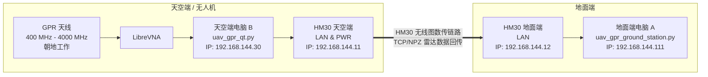

# UAV-GPR 远程数据传输方案汇总与 HM30 最终推荐方案

版本日期：2026-07-10

## 1. 目标

本项目需要将无人机探地雷达天空端电脑采集到的雷达数据，稳定传输到地面端电脑。

系统当前软件基础为：

```text
天空端电脑 B:
  uav_gpr_qt.py
  LibreVNA + GNSS + GPR 天线
  本地保存 CSV / NPZ / metadata
  TCP 发送压缩 NPZ trace

地面端电脑 A:
  uav_gpr_ground_station.py
  TCP 监听 8765
  接收 trace
  sha256 校验
  保存 remote_runs/
  实时显示 S 参数 / A-scan / B-scan / GNSS
```

当前雷达扫频范围约为：

```text
400 MHz - 4000 MHz
```

单条 trace 通常为几十 KB，数据量不大。真正需要解决的是链路稳定性、机载尺寸、供电可靠性、飞行姿态影响，以及无线设备对雷达测量的干扰。

## 2. 方案汇总

| 方案 | 优点 | 缺点 | 适合程度 |
|---|---|---|---|
| 笔记本热点 | 不加硬件，调试最快 | 距离短，稳定性弱，受 Windows 热点和防火墙影响 | 只适合近距离调试 |
| 普通 Wi-Fi 路由器 | 成本低，配置简单 | 不适合飞行远距离，抗干扰一般 | 适合室内/场地联调 |
| 小型 5.8G Wi-Fi 网桥，如 VONETS | 尺寸小，便宜，能做基础 IP 链路 | 距离和链路余量有限，不是无人机专用 | 低成本备选 |
| 大型 5.8G 室外网桥，如 CPE710/LiteBeam | 距离远，带宽大，稳定 | 机载端太大，定向天线对姿态敏感 | 适合地面固定端，不适合直接上机 |
| 4G/5G CPE + VPN | 不依赖视距，远距离方便 | 延迟和掉线不可控，依赖运营商和 VPN | 远距离备选 |
| 专业无人机图数传 HM30 | 小尺寸、远距离、无人机专用、支持网口链路 | 成本高于普通网桥，需要按手册配置和实测 | 最推荐 |
| 本地存储后落地取数 | 最可靠 | 无法实时查看 | 必须保留为兜底 |

最终建议：

```text
正式方案：HM30 20KM 图数传链路
低成本备选：VONETS VAP11S-5G
调试方案：笔记本热点
兜底方案：天空端本地保存
```

## 3. 为什么最终落脚到 HM30

经过手册检查和客服确认，HM30 能实现天空端电脑与地面端电脑之间的 TCP/IP 数据传输，因此可以承载当前 UAV-GPR 的 TCP/NPZ 回传链路。

HM30 相比普通 5.8G Wi-Fi 网桥更适合本项目：

- 天空端尺寸小，适合上无人机。
- 天空端重量较轻。
- 面向无人机场景，飞行姿态和远距离链路考虑更充分。
- 地面端和天空端均具备网口链路基础。
- 距离余量明显高于普通小型 Wi-Fi 网桥。
- 不需要重写现有数据传输软件，只需要配置 IP 和端口。

## 4. HM30 手册关键信息

根据 `docs/HM30 v1.7.pdf`：

| 项目 | 手册信息 | 对本项目意义 |
|---|---|---|
| 最大通信距离 | 20 km，无干扰、无遮挡 | 外场链路余量足够，但实际距离需测试 |
| 天空端尺寸 | 70 x 55 x 16 mm，不含风扇高度 | 适合机载 |
| 天空端重量 | 74 g，不含天线 | 机载负担可接受 |
| 天空端接口 | `LAN & PWR (GH1.25 8-Pin)` | 可接天空端电脑网口 |
| 地面端接口 | `LAN (GH1.25 4-Pin)` | 可接地面端电脑 |
| 天空端供电 | 3S-6S / 12.6-25.2 V | 可接机载电源，需确认版本 |
| 天空端功耗 | 均值 2.8 W，峰值 12 W | 供电需留足峰值余量 |
| 天线 | 天空端标准全向 5 dBi | 比机载定向网桥更适合姿态变化 |

手册默认 IP：

```text
HM30 天空端: 192.168.144.11
HM30 地面端: 192.168.144.12
手持地面站安卓系统: 192.168.144.20
常见相机/吊舱: 192.168.144.25
```

手册示例中，Windows 设备可设置为：

```text
IP: 192.168.144.111
Mask: 255.255.255.0
Gateway: 192.168.144.12
```

## 5. 最终推荐拓扑



## 6. IP 与软件配置

建议沿用 HM30 默认网段 `192.168.144.0/24`。

### 6.1 地面端电脑 A

以太网 IPv4：

```text
IP 地址: 192.168.144.111
子网掩码: 255.255.255.0
默认网关: 192.168.144.12
```

启动地面站：

```powershell
python .\uav_gpr_ground_station.py --host 0.0.0.0 --port 8765 --out .\remote_runs
```

### 6.2 天空端电脑 B

以太网 IPv4：

```text
IP 地址: 192.168.144.30
子网掩码: 255.255.255.0
默认网关: 192.168.144.12
```

天空端软件配置：

```text
Remote send: enabled
Remote IP: 192.168.144.111
Port: 8765
```

启动采集端：

```powershell
python .\uav_gpr_qt.py
```

## 7. 连通性测试

### 7.1 基础 ping 测试

地面端电脑 A：

```powershell
ping 192.168.144.12
ping 192.168.144.11
ping 192.168.144.30
```

天空端电脑 B：

```powershell
ping 192.168.144.11
ping 192.168.144.12
ping 192.168.144.111
```

### 7.2 TCP 端口测试

先在地面端启动：

```powershell
python .\uav_gpr_ground_station.py --host 0.0.0.0 --port 8765 --out .\remote_runs
```

再在天空端测试：

```powershell
Test-NetConnection 192.168.144.111 -Port 8765
```

如果 `TcpTestSucceeded` 为 `True`，说明 HM30 链路可以承载当前 TCP 数据回传。

### 7.3 雷达 trace 回传测试

1. 天空端启动 `uav_gpr_qt.py`。
2. 地面端启动 `uav_gpr_ground_station.py`。
3. 采集 10 条 trace。
4. 检查地面端 `remote_runs/<run_id>/` 是否生成 NPZ。
5. 检查地面端 B-scan 是否更新。
6. 检查 `run_metadata.jsonl` 中 `sha256` 是否完整。

## 8. 干扰风险与安装建议

HM30 工作频段高于当前 GPR 主扫频范围，原则上比 2.4G、1.4G、900M 链路更适合当前 `400 MHz - 4000 MHz` 雷达系统。但仍然需要注意近场耦合和线缆串扰。

主要风险：

- HM30 天线离 GPR 天线太近，产生近场耦合。
- HM30 天线离 LibreVNA 或 RF 馈线太近，导致前端噪声或非线性干扰。
- HM30 供电 DC-DC 纹波串入采集系统。
- 网线、USB 线、RF 线布线靠得太近。
- 图传大流量占用链路，影响雷达数据回传稳定性。

推荐安装：

```text
无人机上方 / 侧上方:
  HM30 天空端
  HM30 两根天线
  天线尽量朝向地面端方向

无人机中部:
  天空端电脑
  LibreVNA
  供电模块

无人机下方:
  GPR 天线朝地
```

安装原则：

- HM30 天空端与 GNSS 模块至少间距 20 cm，手册也有类似建议。
- 对本项目，HM30 天线与 GPR 天线、LibreVNA、RF 馈线尽量拉开，建议至少 50 cm，条件允许时接近 1 m。
- HM30 两根天线不要贴在一起，手册建议至少间隔 50 mm。
- HM30 天线馈线不要交叉，不要贴金属或碳纤维结构件。
- RF 馈线、USB 线、网线加磁环。
- HM30 供电与 LibreVNA/采集电脑供电尽量分开 DC-DC。
- 只传雷达数据时，关闭不必要的视频拉流，降低链路占用和发热。

## 9. 干扰验证实验

正式飞行前必须做开关对比测试。

| 组别 | HM30 状态 | 数据传输状态 | 目的 |
|---|---|---|---|
| A | 关闭 | 无 | 雷达基线 |
| B | 开启 | 空闲 | 看 HM30 载波影响 |
| C | 开启 | 连续传 trace | 看正常回传影响 |
| D | 开启 | 大流量传输 | 看最坏情况 |

每组采集 50-100 条 trace，对比：

- S 参数曲线是否整体抬升；
- A-scan 是否出现固定尖峰；
- B-scan 是否出现横纹或竖纹；
- GNSS 是否掉 fix；
- trace 间随机噪声是否增加；
- 地面端是否出现 trace 缺号。

如果有明显干扰，优先调整：

1. 增大 HM30 天线与 GPR 天线/LibreVNA/RF 线距离。
2. 调整天线方向。
3. 给网线、USB、RF 线增加磁环。
4. 分离供电 DC-DC。
5. 降低不必要的视频流或关闭视频流。

## 10. 稳定性增强建议

HM30 可以解决大部分无线链路问题，但软件仍建议补强：

1. 增加 heartbeat，地面端显示天空端在线、采集状态、队列长度。
2. 增加持久化发送队列，例如 `outbox_manifest.jsonl` 或 SQLite。
3. 增加断线补传，网络恢复后自动补齐未 ACK 的 trace。
4. 增加 `Data only` 模式，地面端只接收雷达数据，不主动控制采集。
5. 增加链路测试按钮，自动执行 ping 和 TCP 8765 测试。

## 11. 最终结论

客服已确认 HM30 可实现天空端电脑与地面端电脑之间的数据传输，结合手册中 LAN、IP、UDP、RTSP 和第三方网口设备支持信息，可以判断 HM30 能作为 UAV-GPR 远程雷达数据回传的正式链路方案。

最终推荐：

```text
正式外场链路:
  HM30 20KM

数据协议:
  继续使用当前 TCP socket + NPZ + sha256

地面端:
  192.168.144.111:8765
  uav_gpr_ground_station.py

天空端:
  192.168.144.30
  uav_gpr_qt.py
  Remote IP = 192.168.144.111

可靠性策略:
  天空端本地保存优先
  地面端实时接收校验
  后续增加 heartbeat 与断线补传
```

一句话结论：

```text
HM30 是当前最适合本项目的正式无线传输方案；
它兼顾机载尺寸、传输距离、无人机场景适配和现有软件兼容性。
```
