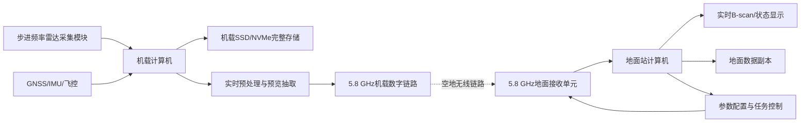

# 无人机步进频率探地雷达数据回传系统技术方案报告

**项目对象：** 400 MHz–4000 MHz、201个频点的步进频率无人机探地雷达  
**当前阶段：** 已完成雷达数据采集，拟建设无人机端至地面端的数据回传链路  
**近期目标：** 视距条件下约 1 km 稳定回传  
**报告日期：** 2026年7月10日

---

## 1. 项目背景与建设目标

本项目拟在无人机搭载的步进频率探地雷达系统中增加无线数据回传能力，使地面端能够实时接收雷达数据、无人机位置姿态信息和设备状态信息，并完成实时剖面显示、采集质量检查和任务控制。

雷达工作频率覆盖 **400 MHz–4000 MHz**。该频段跨度较大，常见的 433 MHz、800/900 MHz、1.4 GHz、2.4 GHz 和部分 4G/5G 通信频段均可能落入雷达接收带内。因此，数据回传系统除满足距离和带宽要求外，还必须重点解决无线发射机对雷达接收机的电磁干扰问题。

本系统建议达到以下基本目标：

1. 视距条件下实现约 1 km 稳定数据回传；
2. 有效业务吞吐率不低于实际雷达原始数据率的 2 倍；
3. 无线链路中断时，机载端不丢失原始数据；
4. 地面端能够实时显示雷达剖面、链路状态和无人机位置姿态；
5. 通信系统不能明显抬高雷达噪声底或产生固定频点杂散；
6. 支持后续扩展至数公里链路、4G/5G备份链路或专用工业数传链路。

---

## 2. 总体技术结论

对于 400 MHz–4000 MHz 步进频率雷达，推荐采用：

> **机载本地完整存储 + 5.8 GHz 双向以太网数字链路 + 地面定向天线 + 雷达采集与无线发射时分避让。**

核心理由如下：

- 5.8 GHz 位于雷达最高工作频率 4 GHz 之外，相比 433 MHz、900 MHz 和 2.4 GHz，直接落入雷达接收带的风险更低；
- 以太网链路可以直接承载 TCP、UDP、QUIC、文件同步和远程控制，便于软件开发；
- 地面端使用高增益定向天线，可以降低机载发射功率，减轻机载电磁干扰；
- 机载 SSD 保存完整原始数据，可以避免无线掉线造成不可恢复的数据缺失；
- 通过时分工作、天线隔离、屏蔽、滤波和独立供电，可进一步降低无线数传对雷达的影响。

不建议将 433 MHz、900 MHz、1.4 GHz 或 2.4 GHz 数传作为雷达原始数据的主回传链路。低速 SiK 数传可以保留用于飞控遥测或应急控制，但其带宽通常不足以承担雷达原始数据。

---

## 3. 数据带宽需求分析

### 3.1 原始数据率计算

设：

- $N_f$：每道雷达数据的频率点数；
- $N_c$：采集通道数；
- $b$：每个复数频率点占用的字节数；
- $R$：每秒采集的雷达道数。

原始数据率为：

$$
B=N_f\times N_c\times b\times R\times 8
$$

常见数据格式：

- 复数 int16：4 Byte/点；
- 复数 float32：8 Byte/点；
- 复数 float64：16 Byte/点。

### 3.2 按201个频点重新计算

本系统计划采用 **201个频率点**。在该条件下，原始数据量相对较小，数据链路的主要矛盾不再是峰值带宽，而是无线传输稳定性、断线保护和对雷达接收机的电磁干扰。

| 频点数 | 通道数 | 数据格式 | 道率 | 原始数据率 |
|---:|---:|---:|---:|---:|
| 201 | 1 | complex float32 | 10 道/s | 约 0.129 Mbps |
| 201 | 2 | complex float32 | 20 道/s | 约 0.515 Mbps |
| 201 | 4 | complex float32 | 20 道/s | 约 1.029 Mbps |
| 201 | 4 | complex float64 | 20 道/s | 约 2.058 Mbps |
| 201 | 4 | complex float32 | 50 道/s | 约 2.573 Mbps |
| 201 | 4 | complex float32 | 100 道/s | 约 5.146 Mbps |

其中，complex float32按每个复数频点8 Byte计算，complex float64按16 Byte计算。

例如，在较典型的四通道、complex float32、20道/s条件下：

$$
B=201\times4\times8\times20\times8
=1{,}029{,}120\ \mathrm{bit/s}
\approx1.03\ \mathrm{Mbps}
$$

即使加入GNSS/IMU信息、数据包头、校验、重传和链路波动，持续有效吞吐率达到 **10 Mbps** 通常已经具有较充分余量。若未来提高至100道/s，或者同时传输实时成像结果、设备日志和控制数据，建议保证不低于 **15–20 Mbps** 的稳定有效吞吐率。

因此，对当前201频点系统建议采用以下链路指标：

- 最低可用有效吞吐率：5 Mbps；
- 推荐稳定有效吞吐率：10–20 Mbps；
- 推荐物理链路能力：不低于百兆以太网接口；
- 链路设计余量：至少为最大原始数据率的2–3倍；
- 对于仅回传单通道或双通道数据，普通5.8 GHz数字链路已绰绰有余。

需要强调的是，商家标注的300 Mbps、866 Mbps等通常是无线物理层速率，并非实际业务吞吐率。对本系统而言，不需要盲目追求高空口速率，而应优先关注：

1. 5.8 GHz频段是否可固定；
2. 是否支持透明Ethernet；
3. 是否能限制或关闭雷达采集期间的无线发射；
4. 1 km视距条件下的持续稳定性；
5. 断线重连和机载本地存储能力；
6. 无线发射是否明显抬高雷达噪声底。

---

## 4. 候选技术方案比较

| 技术方案 | 可用带宽 | 典型距离 | 电磁兼容性 | 开发难度 | 适用阶段 |
|---|---:|---:|---|---|---|
| 5.8 GHz Wi-Fi/OpenWrt 网桥 | 中高 | 1–5 km视距 | 较好 | 中 | 低成本验证、定制开发 |
| 5.8 GHz 无人机专用数字链路 | 中高 | 数公里至20 km以上，取决于型号和环境 | 较好 | 低至中 | 工程样机、产品化 |
| DJI Payload SDK 链路 | 取决于机型和通道分配 | 取决于无人机链路 | 较好 | 中高 | 使用DJI行业平台时 |
| 4G/5G公网链路 | 波动较大 | 有网络覆盖即可 | 较差至中 | 中 | 备份、超视距 |
| 433/900 MHz SiK | 很低 | 1 km以上 | 差 | 低 | 飞控遥测，不传原始雷达数据 |
| 2.4 GHz Wi-Fi/图传 | 中高 | 1–数公里 | 差 | 低 | 不建议用于本雷达主链路 |

### 4.1 方案A：5.8 GHz无人机专用数字链路

优先考虑支持以下功能的型号：

- 5.1–5.8 GHz 工作频段；
- 机载端和地面端均提供 Ethernet；
- 支持 TCP/IP 和 UDP 透明传输；
- 机载端重量低、功耗可接受；
- 可固定信道、带宽和发射功率；
- 最好提供射频静默、TX inhibit 或可控发射接口；
- 支持外置天线；
- 能够获取链路 RSSI、吞吐率和丢包率。

**SIYI HM30** 是适合快速形成工程样机的一类设备。其官方页面给出了以太网接口、机载单元和地面单元，以及 5 GHz 频段的数字链路能力。官方标称距离属于理想视距测试结果，不能直接等同于挂载雷达后的有效距离，必须通过实际吞吐测试和电磁兼容测试确认。

适用情况：

- 希望快速完成 1 km 原型；
- 不希望自行开发射频链路；
- 需要同时承载雷达数据、遥测和控制；
- 可接受整套设备的成本和重量。

### 4.2 方案B：5.8 GHz OpenWrt/MESH板卡自建链路

可采用一对支持 5 GHz、MIMO、Ethernet 和 OpenWrt 的网桥板卡：

- 机载端配置全向或圆极化天线；
- 地面端配置 15–20 dBi 定向平板天线；
- 固定 5.8 GHz 信道；
- 优先使用 20 MHz 信道带宽；
- 通过 `iperf3` 验证真实 UDP/TCP 吞吐率；
- 通过 OpenWrt 设置 QoS、固定速率、静态 IP、关闭漫游和不必要广播。

该方案成本较低，软件可控性强，适合科研开发。但需要自行完成供电、散热、外壳、天线匹配、链路管理和电磁兼容设计。

### 4.3 方案C：5.8 GHz普通无线网桥

室外监控类 5.8 GHz CPE 网桥价格低、吞吐率较高，可用于地面静态测试和链路预算验证。但常规 CPE 通常体积和重量较大，不适合作为最终机载单元。

推荐用途：

- 在地面进行 1 km 视距通信试验；
- 验证 TCP/UDP 传输软件；
- 验证天线方向、丢包率和吞吐率；
- 作为地面端接收设备。

不建议直接把两只大型室外 CPE 都安装到无人机上。

### 4.4 方案D：4G/5G备份链路

4G/5G可用于：

- 远程查看状态；
- 低速预览；
- 超视距任务的备份通信；
- 主链路断开后的报警与定位。

但蜂窝通信频段可能落在雷达工作带内，而且公网带宽、时延和覆盖不稳定。因此不建议在第一版系统中将其作为唯一的原始数据链路。

---

## 5. 推荐系统架构



### 5.1 数据分级

建议将数据分为三级：

1. **A级：完整原始数据**  
   始终写入机载 SSD，是最终可信数据源。

2. **B级：实时原始数据流**  
   链路条件允许时向地面端传输，用于实时成像和质量检查。

3. **C级：预览与状态数据**  
   包括降采样剖面、设备温度、存储空间、RSSI、GNSS、姿态和采集进度。即使链路较差，也应优先保证该部分传输。

---

## 6. 通信协议设计

### 6.1 第一阶段原型

按照201个频点的当前设计，雷达数据率通常低于约5 Mbps，因此第一阶段可直接使用 TCP：

- 开发简单；
- 自动保证顺序和完整性；
- 便于快速联调；
- 适合实验室和短距离试验。

需要注意：链路丢包时，TCP重传可能导致实时显示延迟突然增加。因此机载端仍应独立写盘，地面端显示线程不能阻塞采集线程。

### 6.2 工程化阶段

建议采用：

- 控制命令：TCP、QUIC 或 WebSocket；
- 雷达实时数据：UDP 分片；
- 文件补传：SFTP、rsync、HTTP 或自定义可靠文件传输；
- 心跳和状态：独立低速 UDP/TCP 通道。

### 6.3 建议数据包字段

| 字段 | 作用 |
|---|---|
| 协议版本 | 便于后续升级 |
| 任务编号 | 区分不同飞行任务 |
| 雷达道编号 | 保证数据顺序 |
| GNSS时间戳 | 与无人机位置同步 |
| 位置与姿态 | 用于成像和轨迹校正 |
| 起始频率 | 描述扫频参数 |
| 频率步长 | 描述扫频参数 |
| 频点数 | 数据解析 |
| 通道/极化编号 | 区分采集通道 |
| 分片编号与总分片数 | UDP重组 |
| 数据长度 | 完整性检查 |
| CRC32 | 检测传输错误 |

UDP单包建议控制在约 1200–1400 Byte，避免路径 MTU 不一致导致IP层分片。

---

## 7. 电磁兼容设计

### 7.1 频段选择

主数据链应尽量固定在 5.8 GHz。避免使用以下频段作为主链路：

- 433 MHz；
- 800/900 MHz；
- 1.4 GHz；
- 2.4 GHz；
- 任何落入 400–4000 MHz 的高功率自定义数传频点。

即使通信载波不等于某个雷达步进点，强近场信号仍可能通过接收机非线性产生压缩、谐波和互调。

### 7.2 时间隔离

推荐时序：

```text
雷达开始扫频
    ↓
机载数传停止发送业务数据
    ↓
雷达完成一条或一组数据采集
    ↓
无线链路突发上传
    ↓
进入下一次扫频
```

注意：普通 Wi-Fi 即使没有业务数据，也可能发送 Beacon、ACK、探测帧和管理帧。因此：

- 地面端作为 AP；
- 机载端作为 Station；
- 固定 AP、信道和带宽；
- 关闭主动扫描、自动漫游和自动信道选择；
- 雷达采集窗口内避免地面端向无人机发送数据；
- 优先选择支持硬件射频静默或功放使能控制的数传模块；
- 不建议频繁切断整个数传模块电源，优先控制其发射使能。

### 7.3 空间隔离

建议布置：

- 雷达天线置于无人机下方；
- 数传天线置于机身上方；
- 两者间距尽可能达到 0.5 m 或以上；
- 中间使用机架、金属底板或专用屏蔽板形成隔离；
- 数传天线可采用与雷达极化正交的方向；
- 通信馈线、电源线和雷达接收线避免长距离平行；
- 地面端使用定向天线，减少机载端所需发射功率。

### 7.4 射频滤波

可在雷达接收前端增加低通滤波器，要求：

- 400–4000 MHz 内插入损耗尽可能小；
- 4 GHz附近幅相响应可标定；
- 对 5.1–5.8 GHz 有足够抑制度；
- 不能直接选择截止频率过低的通用4 GHz低通滤波器；
- 最好根据雷达前端阻抗、动态范围和校准需求定制。

对于步进频率雷达，滤波器的频率相关幅度和相位必须纳入系统校准。

### 7.5 电源与结构

- 雷达模拟部分与数传模块使用独立 DC-DC；
- 数传电源入口增加 LC 或 π 型滤波；
- DC-DC 与雷达接收前端保持距离；
- 数传、计算机和雷达前端分别使用屏蔽腔体；
- 屏蔽层采用单点或经过设计的接地方式；
- 机载以太网线使用屏蔽双绞线，控制长度；
- 必要时采用光纤或以太网隔离器进行地面测试。

---

## 8. 淘宝采购建议

> 说明：淘宝单品页面、库存和价格变化较快，且部分商品链接需要登录后才能访问。下面优先提供相对稳定的淘宝搜索链接，并给出应核对的关键参数。购买前应向商家索取完整规格书，确认工作频段、实际以太网吞吐率、机载端重量、功耗、发射功率和接口定义。

### 8.1 方案一：快速工程样机——SIYI HM30

- 淘宝搜索：[SIYI HM30](https://s.taobao.com/search?q=SIYI%20HM30)
- 淘宝搜索：[四意 HM30 数字图传](https://s.taobao.com/search?q=%E5%9B%9B%E6%84%8F%20HM30%20%E6%95%B0%E5%AD%97%E5%9B%BE%E4%BC%A0)
- 官方产品页：[SIYI HM30](https://siyi.biz/en/product/image-digital-link/hm30/)
- 官方规格页：[HM30 Specifications](https://siyi.biz/product/image-digital-link/hm30/spec)

**购买时确认：**

- 套装是否同时包含机载端和地面端；
- 机载端是否提供可直接使用的 Ethernet；
- 是否允许透明传输自定义 UDP/TCP 数据；
- 真实持续吞吐率，而不是无线空口速率；
- 工作频点是否可固定在 5.8 GHz；
- 是否可关闭自动信道切换；
- 能否控制发射功率；
- 是否提供RSSI、链路质量和丢包信息；
- 机载端重量、尺寸和供电电压。

**定位：** 当前最推荐的快速原型方案。

### 8.2 方案二：可定制OpenWrt/MESH板卡

- 淘宝搜索：[5.8G MESH 网桥主板](https://s.taobao.com/search?q=5.8G%20MESH%20%E7%BD%91%E6%A1%A5%E4%B8%BB%E6%9D%BF)
- 淘宝搜索：[E750A 5.8G MESH 网桥](https://s.taobao.com/search?q=E750A%205.8G%20MESH%20%E7%BD%91%E6%A1%A5)
- 淘宝搜索：[5.8G OpenWrt 网桥板卡 千兆网口](https://s.taobao.com/search?q=5.8G%20OpenWrt%20%E7%BD%91%E6%A1%A5%E6%9D%BF%E5%8D%A1%20%E5%8D%83%E5%85%86%E7%BD%91%E5%8F%A3)
- 参考厂商页面：[E750A 5.8G MESH网桥主板](https://qxwlan.com/prodcut/E750A.html)

**购买时确认：**

- 仅使用5 GHz射频时，2.4 GHz部分能否彻底关闭；
- Ethernet是否为百兆或千兆；
- 实测TCP/UDP吞吐率；
- 是否支持固定信道、5/10/20 MHz带宽；
- 发射功率是否可调；
- 是否开放 OpenWrt SDK；
- 机载板卡重量、峰值功耗和工作温度；
- 是否支持 GPIO 或软件射频静默。

**定位：** 适合科研定制和后续产品化，开发工作量高于HM30。

### 8.3 方案三：低成本地面链路测试——5.8 GHz室外网桥

- 淘宝搜索：[5.8G 无线网桥 千兆 1公里](https://s.taobao.com/search?q=5.8G%20%E6%97%A0%E7%BA%BF%E7%BD%91%E6%A1%A5%20%E5%8D%83%E5%85%86%201%E5%85%AC%E9%87%8C)
- 淘宝搜索：[大华 5.8G 无线网桥](https://s.taobao.com/search?q=%E5%A4%A7%E5%8D%8E%205.8G%20%E6%97%A0%E7%BA%BF%E7%BD%91%E6%A1%A5)
- 淘宝搜索：[COMFAST 5.8G 无线网桥](https://s.taobao.com/search?q=COMFAST%205.8G%20%E6%97%A0%E7%BA%BF%E7%BD%91%E6%A1%A5)
- 淘宝搜索：[UBNT LocoM5 5.8G 网桥](https://s.taobao.com/search?q=UBNT%20LocoM5%205.8G%20%E7%BD%91%E6%A1%A5)

**购买时确认：**

- 必须是5 GHz/5.8 GHz型号，而不是2.4 GHz型号；
- Ethernet端口是否只有百兆；
- 能否固定20 MHz信道带宽；
- 能否关闭自动信道选择；
- 单只重量和功耗；
- PoE供电是否适合机载电源；
- 是否支持点对点桥接和透明二层传输。

**定位：** 适合地面静态和软件联调。多数产品偏重，不建议直接作为最终机载设备。

### 8.4 低速辅助模块——HLK-RM58S

- 淘宝搜索：[HLK-RM58S](https://s.taobao.com/search?q=HLK-RM58S)
- 官方页面：[HLK-RM58S](https://www.gicisky.net/Goods-28.html)

该模块支持2.4/5.8 GHz和串口透传，但不应在未确认实际吞吐率前承担雷达原始数据主链路。它更适合：

- 状态信息回传；
- 低速控制命令；
- 台架原理验证。

### 8.5 天线与射频附件

#### 机载5.8 GHz天线

- 淘宝搜索：[5.8G 全向天线 SMA 3dBi](https://s.taobao.com/search?q=5.8G%20%E5%85%A8%E5%90%91%E5%A4%A9%E7%BA%BF%20SMA%203dBi)
- 淘宝搜索：[5.8G 圆极化棒状天线 SMA](https://s.taobao.com/search?q=5.8G%20%E5%9C%86%E6%9E%81%E5%8C%96%E6%A3%92%E7%8A%B6%E5%A4%A9%E7%BA%BF%20SMA)

建议选择：

- 3–5 dBi；
- 轻量化；
- SMA接口；
- 具有较好的俯仰方向覆盖；
- 驻波比和频率范围有明确测试数据。

不要盲目使用高增益机载全向天线。高增益天线垂直波束较窄，无人机俯仰、横滚后可能产生链路衰落。

#### 地面定向天线

- 淘宝搜索：[5.8G 17dBi 平板定向天线 SMA](https://s.taobao.com/search?q=5.8G%2017dBi%20%E5%B9%B3%E6%9D%BF%E5%AE%9A%E5%90%91%E5%A4%A9%E7%BA%BF%20SMA)
- 淘宝搜索：[5.8G 20dBi 定向天线 网桥](https://s.taobao.com/search?q=5.8G%2020dBi%20%E5%AE%9A%E5%90%91%E5%A4%A9%E7%BA%BF%20%E7%BD%91%E6%A1%A5)

1 km视距试验建议从 15–20 dBi 地面定向天线开始。飞行轨迹范围较大时，可增加云台或自动跟踪装置。

#### 雷达接收端低通滤波器

- 淘宝搜索：[4.2GHz 低通滤波器 SMA](https://s.taobao.com/search?q=4.2GHz%20%E4%BD%8E%E9%80%9A%E6%BB%A4%E6%B3%A2%E5%99%A8%20SMA)
- 淘宝搜索：[4.5GHz 低通滤波器 SMA 5.8G抑制](https://s.taobao.com/search?q=4.5GHz%20%E4%BD%8E%E9%80%9A%E6%BB%A4%E6%B3%A2%E5%99%A8%20SMA%205.8G%E6%8A%91%E5%88%B6)
- 淘宝搜索：[射频低通滤波器 定制 4GHz](https://s.taobao.com/search?q=%E5%B0%84%E9%A2%91%E4%BD%8E%E9%80%9A%E6%BB%A4%E6%B3%A2%E5%99%A8%20%E5%AE%9A%E5%88%B6%204GHz)

购买前必须向商家索取 S 参数文件或至少提供：

- 400 MHz–4000 MHz 插入损耗；
- 群时延或相位响应；
- 5.1–5.8 GHz 抑制度；
- 功率容量；
- 接口形式；
- 50 Ω阻抗。

#### 电磁兼容附件

- 淘宝搜索：[铝合金屏蔽盒 射频模块](https://s.taobao.com/search?q=%E9%93%9D%E5%90%88%E9%87%91%E5%B1%8F%E8%94%BD%E7%9B%92%20%E5%B0%84%E9%A2%91%E6%A8%A1%E5%9D%97)
- 淘宝搜索：[穿心电容 EMI 电源滤波](https://s.taobao.com/search?q=%E7%A9%BF%E5%BF%83%E7%94%B5%E5%AE%B9%20EMI%20%E7%94%B5%E6%BA%90%E6%BB%A4%E6%B3%A2)
- 淘宝搜索：[共模电感 以太网 EMI 滤波](https://s.taobao.com/search?q=%E5%85%B1%E6%A8%A1%E7%94%B5%E6%84%9F%20%E4%BB%A5%E5%A4%AA%E7%BD%91%20EMI%20%E6%BB%A4%E6%B3%A2)
- 淘宝搜索：[低噪声 DC-DC 模块 12V 5V](https://s.taobao.com/search?q=%E4%BD%8E%E5%99%AA%E5%A3%B0%20DC-DC%20%E6%A8%A1%E5%9D%97%2012V%205V)

---

## 9. 推荐采购组合

### 9.1 低成本验证组合

适用于实验室、地面静态和短距离外场：

| 部件 | 建议 |
|---|---|
| 5.8 GHz链路 | 一对5.8 GHz室外网桥 |
| 机载模拟端 | 初期可暂用普通小型计算机或路由板 |
| 地面天线 | 网桥自带定向天线 |
| 数据协议 | TCP |
| 存储 | 机载SSD |
| 测试工具 | `iperf3`、Wireshark、频谱仪 |
| 主要目的 | 验证数据软件、带宽和1 km链路 |

该组合不一定适合最终飞行，主要用于证明通信方案可行。

### 9.2 1 km工程样机组合

| 部件 | 建议 |
|---|---|
| 主链路 | SIYI HM30 或同类5.8 GHz Ethernet无人机数字链路 |
| 机载天线 | 3–5 dBi全向/圆极化天线 |
| 地面天线 | 原厂定向天线或15–20 dBi平板天线 |
| 机载计算机 | 具备千兆网口或USB3.0网卡 |
| 机载存储 | SSD/NVMe |
| 传输协议 | TCP原型，后续UDP分片 |
| EMC | 独立DC-DC、屏蔽盒、低通滤波、上下分置天线 |
| 同步 | 雷达采集触发与无线突发上传时序协调 |

这是当前最推荐的落地路线。

### 9.3 可产品化组合

| 部件 | 建议 |
|---|---|
| 主链路 | 轻量化5.8 GHz MIMO/MESH板卡 |
| 射频控制 | 支持固定频点、功率控制和TX inhibit |
| 地面站 | 定向天线+自动跟踪 |
| 协议 | UDP+FEC+文件补传 |
| 存储 | 双副本或工业SSD |
| 备份链路 | 4G/5G低速状态链路 |
| EMC | 定制滤波器、分腔屏蔽、电源完整性设计 |
| 软件 | 链路自适应、断点续传、数据质量监控 |

---

## 10. 实施步骤

### 第一阶段：带宽与软件验证

1. 明确频点数、通道数、数据类型和最大道率；
2. 计算峰值和平均数据率；
3. 在有线以太网上完成 TCP 数据传输；
4. 实现机载本地写盘和地面实时显示；
5. 使用 `iperf3` 测量 TCP/UDP 持续吞吐；
6. 验证断网后机载采集不受影响。

### 第二阶段：5.8 GHz静态试验

1. 空场条件下完成 10 m、100 m、500 m和1 km测试；
2. 测量吞吐率、RTT、抖动、丢包率和重连时间；
3. 调整地面天线方向、信道带宽和发射功率；
4. 测试固定20 MHz信道是否满足数据率；
5. 比较TCP和UDP传输性能。

### 第三阶段：电磁兼容试验

依次测试：

1. 雷达独立工作；
2. 数传上电但不建立链路；
3. 数传建立链路但不发送业务数据；
4. 数传以1 Mbps发送；
5. 数传以5 Mbps发送；
6. 数传以最大速率发送；
7. 无人机电机和ESC运行；
8. 电机、雷达和数传同时运行；
9. 加入屏蔽、滤波和时分控制后复测。

对每种状态记录：

- 各频点噪声均值和标准差；
- 固定杂散频点；
- 接收动态范围；
- 幅度和相位稳定性；
- 雷达成像背景噪声；
- 数传RSSI、吞吐率和丢包率。

### 第四阶段：悬停和航线试验

1. 低高度悬停；
2. 直线往返；
3. 不同俯仰和横滚姿态；
4. 500 m和1 km视距飞行；
5. 天线遮挡和机体转向测试；
6. 短时掉线、自动重连和数据补传测试；
7. 完成真实目标物雷达数据采集。

---

## 11. 验收指标建议

| 指标 | 建议目标 |
|---|---|
| 视距通信距离 | 不低于1 km |
| 持续有效吞吐率 | 建议不低于10 Mbps，且不低于最大原始数据率的2–3倍 |
| 地面预览延迟 | 正常状态下小于1 s |
| 状态数据更新率 | 不低于5–10 Hz |
| 无线断开时原始数据 | 机载端零丢失 |
| 自动重连时间 | 目标小于5 s |
| 雷达噪声底变化 | 不出现明显、持续抬升 |
| 固定频点干扰 | 不产生影响成像的稳定强杂散 |
| 雷达幅相稳定性 | 满足系统校准和成像要求 |
| 数据完整性 | 道编号、时间戳和CRC可追溯 |

噪声底和幅相稳定性的具体阈值，应根据当前雷达接收机动态范围和目标检测需求，通过基线实验确定。

---

## 12. 风险分析

### 12.1 无线标称速率不等于有效吞吐率

商家标注的300 Mbps、866 Mbps等通常是物理层空口速率。真实TCP/UDP业务吞吐率可能低得多。必须要求提供实测值，并用 `iperf3` 自行测试。

### 12.2 标称距离不等于有效任务距离

标称20 km或30 km通常基于理想视距、特定天线、高空和低干扰条件。雷达平台的金属结构、天线遮挡、电机噪声和飞行姿态都会降低实际链路性能。

### 12.3 5.8 GHz仍可能干扰雷达

虽然载波高于4 GHz，但强信号可能通过接收机非线性和电源耦合进入雷达。因此仍需完成时分、空间隔离、滤波和屏蔽设计。

### 12.4 无线掉线不可避免

不能把无线回传作为唯一的数据保存方式。机载完整存储是必要条件。

### 12.5 淘宝器件参数可能不完整

不应仅根据商品标题购买。必须索取规格书、接口图、功耗、重量、频率范围、真实吞吐率和天线参数。

### 12.6 无线电法规

5.8 GHz频段、发射功率、天线增益和室外使用规则因国家和地区而异。外场飞行前应核对当地无线电管理和无人机运行规定。

---

## 13. 最终推荐

现阶段建议按以下顺序实施：

1. **采用SIYI HM30或同类5.8 GHz Ethernet数字链路完成1 km工程样机；**
2. **机载端使用SSD/NVMe保存全部原始数据；**
3. **第一版采用TCP完成快速开发，稳定后改为UDP分片+文件补传；**
4. **地面端使用定向高增益天线，机载端使用轻量全向天线；**
5. **将雷达天线与通信天线分别布置在无人机下方和上方；**
6. **雷达扫频期间尽可能抑制机载无线发射，扫频间隔集中上传；**
7. **完成从静态、上电、传输、电机运行到飞行状态的分级电磁兼容测试；**
8. **若HM30无法提供所需的射频静默或自定义控制，再转向OpenWrt/MESH板卡定制方案。**

对于当前201个频点、约1 km的需求，数据率通常只有数Mbps，没有必要一开始就购买昂贵的军工级或超远距离MESH链路。先用成熟5.8 GHz无人机数字链路验证完整的数据采集、回传、显示和抗干扰流程，是风险最低、研发效率最高的路线。

---

## 14. 参考资料

1. SIYI HM30官方产品页：  
   https://siyi.biz/en/product/image-digital-link/hm30/

2. SIYI HM30官方规格页：  
   https://siyi.biz/product/image-digital-link/hm30/spec

3. E750A 5.8 GHz MESH网桥主板：  
   https://qxwlan.com/prodcut/E750A.html

4. HLK-RM58S官方产品页：  
   https://www.gicisky.net/Goods-28.html

5. OpenWrt官方网站：  
   https://openwrt.org/

---

**备注：** 本报告中的淘宝链接为搜索链接，便于在不同时间查看在售商品。具体商品库存、价格、参数和卖家信息会发生变化，采购前应重新核对。
